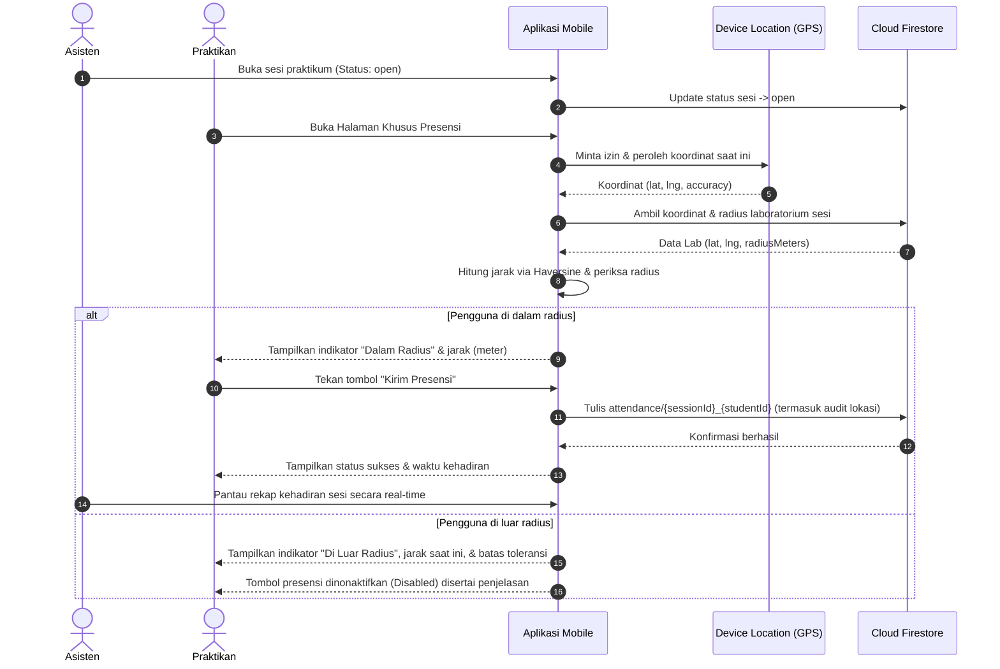
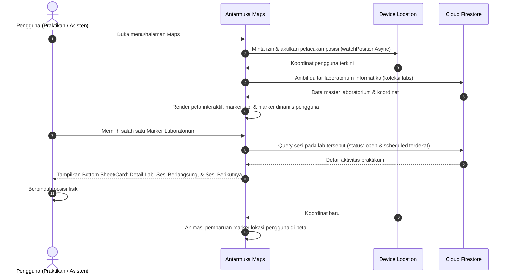
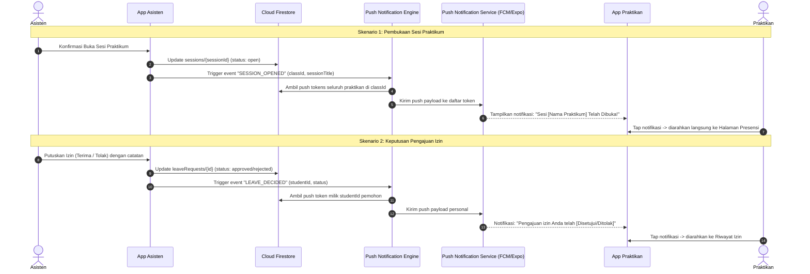

# SRS Sistem Manajemen Praktikum Sprint 3

## Dasar Penyusunan

Sprint 3 merupakan kelanjutan langsung dari Sprint 2 pada aplikasi Sistem Manajemen Praktikum berbasis React Native dan Expo. Pada Sprint 2, sistem telah mengimplementasikan autentikasi multi-pengguna dengan Firebase Authentication, penyimpanan persisten dengan Cloud Firestore, sinkronisasi real-time antarpengguna, serta alur pengajuan dan verifikasi izin praktikum.

Pada Sprint 3, fokus pengembangan diarahkan pada tiga pilar utama:
1. **Presensi Berbasis Lokasi (Location-Based Attendance):** Halaman presensi mandiri yang memvalidasi keberadaan fisik praktikan menggunakan geolokasi perangkat dan perhitungan radius (*geofencing*) terhadap laboratorium praktikum sebelum presensi dicatat ke Firestore.
2. **Peta Interaktif dan Aktivitas Laboratorium (Interactive Maps & Lab Activity):** Visualisasi sebaran laboratorium Informatika, pelacakan posisi dinamis pengguna (*live user location marker*), dan penyajian informasi aktivitas praktikum yang sedang berlangsung (*current session*) maupun praktikum berikutnya (*upcoming session*) secara real-time.
3. **Pemberitahuan Otomatis (Push Notification Engine):** Penyampaian pemberitahuan penting secara langsung ke perangkat praktikan ketika sesi dibuka, jadwal diubah, atau keputusan izin diterbitkan oleh asisten.

Dokumen ini menjadi acuan spesifikasi kebutuhan perangkat lunak (SRS), *acceptance criteria*, arsitektur data Firestore, aturan validasi, penanganan kondisi perangkat, dan batas hak akses untuk Sprint 3.

---

## 1. Pendahuluan dan Ruang Lingkup

### 1.1 Tujuan

Dokumen ini mendefinisikan kebutuhan fungsional dan non-fungsional aplikasi pada Sprint 3, memastikan validasi presensi berbasis lokasi bekerja secara akurat, peta interaktif menyajikan data laboratorium dan aktivitasnya secara konsisten, serta mekanisme *push notification* dapat menyampaikan informasi kritis secara tertarget dan tepat waktu.

### 1.2 Gambaran Sistem

Pengguna (Praktikan dan Asisten) mengakses aplikasi melalui perangkat bergerak (*mobile app*). Asisten dapat mengonfigurasi data laboratorium (titik koordinat lintang/bujur dan radius presensi yang diizinkan). Ketika asisten membuka sesi praktikum, sistem secara otomatis mengirimkan *push notification* ke seluruh praktikan terdaftar. Praktikan yang hendak melakukan presensi berpindah ke Halaman Presensi khusus, di mana aplikasi meminta izin akses GPS, mengambil koordinat saat ini, menghitung jarak ke laboratorium yang bersangkutan, dan memvalidasi apakah praktikan berada dalam radius toleransi. Presensi hanya berhasil dicatat ke Firestore apabila sesi berstatus `open`, belum pernah presensi, dan berada di dalam radius. 

Pada layar Peta (Maps), pengguna dapat melihat sebaran laboratorium Informatika dengan penanda (*marker*), melihat posisi dirinya secara langsung, serta memilih laboratorium tertentu untuk melihat jadwal praktikum yang sedang aktif dan yang akan datang berdasarkan data real-time Firestore.

### 1.3 In Scope

- **Halaman Presensi Khusus:** Layar mandiri terpisah dari detail sesi untuk alur presensi praktikan, memuat ringkasan sesi, visualisasi status radius, jarak ke lab, akurasi GPS, dan tombol submit presensi.
- **Validasi Geofencing & Jarak:** Perhitungan jarak akurat antara koordinat perangkat praktikan dan koordinat laboratorium menggunakan formula *Haversine*, dengan pemeriksaan ambang batas radius presensi yang ditetapkan asisten.
- **Pengelolaan Lokasi Laboratorium:** Modul konfigurasi data laboratorium (nama lab, gedung, koordinat latitude & longitude, serta radius presensi default/kustom) oleh asisten yang tersimpan di Firestore.
- **Peta Interaktif Laboratorium:** Antarmuka Maps yang menampilkan *marker* seluruh laboratorium Informatika, *marker* lokasi terkini pengguna yang diperbarui secara dinamis (*live position tracking*), dan kontrol pemusatan peta.
- **Informasi Aktivitas Laboratorium Real-Time:** *Card/modal/bottom sheet* interaktif saat marker lab dipilih yang menyajikan sesi praktikum yang sedang berjalan (`open`) dan sesi berikutnya (`scheduled`) yang bersumber dari koleksi Firestore.
- **Push Notification Terdistribusi:** Integrasi layanan notifikasi (Firebase Cloud Messaging / Expo Notifications) untuk menyampaikan notifikasi push saat 4 peristiwa penting:
  1. Pembukaan sesi praktikum oleh asisten.
  2. Perubahan jadwal praktikum (reschedule waktu / pemindahan lab).
  3. Keputusan pengajuan izin: diterima (*approved*).
  4. Keputusan pengajuan izin: ditolak (*rejected*).
- **Pengelolaan Token Perangkat:** Registrasi dan sinkronisasi push token perangkat pengguna ke dokumen profil pengguna di Firestore.
- **Penanganan Kondisi Perangkat & Izin:** Penanganan komprehensif saat izin lokasi/notifikasi ditolak pengguna, GPS/layanan lokasi mati (*disabled*), koordinat belum diperoleh/timeout, kehilangan koneksi internet, serta kegagalan pengiriman/penerimaan push notification.
- **Pembaruan Security Rules:** Aturan keamanan Firestore untuk memvalidasi atribut lokasi presensi, integritas data lab, dan registrasi token pengguna.

### 1.4 Out of Scope

- Navigasi rute *turn-by-turn* atau panduan arah jalan raya di luar peta visual.
- Pelacakan latar belakang (*background continuous geolocation tracking*) saat aplikasi ditutup (hanya pelacakan *foreground* saat halaman Maps atau Presensi aktif).
- Pembuatan geofence hardware / beacon Bluetooth BLE.
- Pengelolaan multi-kampus di luar lingkungan Laboratorium Informatika.
- Sistem absensi sidik jari atau biometrik perangkat.

---

## 2. Aktor dan Hak Akses

| Fitur / Layar | Belum Login | Praktikan (`student`) | Asisten (`assistant`) |
|---|:---:|:---:|:---:|
| Autentikasi & Profil Akun | Ya (Login/Register) | Ya | Ya |
| Kelola Data Laboratorium & Radius (CRUD) | Tidak | Hanya Membaca | Ya (Kelola & Ubah) |
| Buka Peta Interaktif & Live Marker | Tidak | Ya | Ya |
| Lihat Aktivitas Lab (Sesi Aktif & Mendatang) | Tidak | Ya | Ya |
| Buka Halaman Khusus Presensi | Tidak | Ya | Tidak (Asisten melihat rekap) |
| Validasi Lokasi & Rekam Presensi Berbasis Radius | Tidak | Ya (Jika dalam radius & sesi `open`) | Tidak |
| Buka & Tutup Sesi Praktikum | Tidak | Tidak | Ya |
| Ubah Jadwal / Reschedule Praktikum | Tidak | Tidak | Ya |
| Ajukan Izin Praktikum | Tidak | Ya | Tidak |
| Tinjau & Putuskan Pengajuan Izin | Tidak | Tidak | Ya |
| Terima Push Notification Sesi Dibuka | Tidak | Ya (Anggota kelas terkait) | Tidak |
| Terima Push Notification Perubahan Jadwal | Tidak | Ya (Anggota kelas terkait) | Tidak |
| Terima Push Notification Keputusan Izin | Tidak | Ya (Pemohon izin bersangkutan) | Tidak |

---

## 3. Terminologi dan Status

| Istilah | Definisi |
|---|---|
| **Laboratorium (`lab`)** | Ruangan fisik laboratorium di lingkungan Informatika yang memiliki koordinat geografis permanen dan radius presensi. |
| **Koordinat (`latitude`, `longitude`)** | Titik garis lintang dan bujur geografis dalam derajat desimal sesuai standar WGS 84. |
| **Radius Presensi (`radiusMeters`)** | Batas jarak toleransi maksimum (dalam meter) dari titik pusat laboratorium tempat praktikan diperbolehkan presensi. |
| **Formula Haversine** | Algoritma matematika untuk menghitung jarak lingkaran besar (*great-circle distance*) antara dua titik koordinat pada permukaan bumi. |
| **Geofencing** | Pembatasan geografis virtual berbasis radius untuk menentukan apakah koordinat perangkat berada di dalam (*inside*) atau di luar (*outside*) area yang diizinkan. |
| **Live User Marker** | Penanda visual pada peta yang merepresentasikan posisi pengguna saat ini dan bergeser secara reaktif mengikuti pergerakan GPS. |
| **Push Token** | Kunci token unik perangkat yang dihasilkan oleh penyedia layanan notifikasi (FCM / Expo Push Service) untuk routing pesan. |
| **Foreground Service** | Akses geolokasi yang hanya berjalan ketika pengguna secara aktif membuka layar aplikasi terkait. |
| **Status Sesi** | Siklus hidup sesi: `scheduled` (terjadwal), `open` (berlangsung/dibuka asisten), dan `closed` (selesai ditutup). |
| **Audit Presensi Lokasi** | Penyimpanan riwayat koordinat praktikan, jarak hitung ke laboratorium, dan status verifikasi radius pada saat submit presensi. |

---

## 4. Aturan Bisnis (Business Rules)

1. **Integritas Lokasi Presensi:** Presensi **wajib** menyertakan data geolokasi perangkat praktikan (`latitude`, `longitude`, `accuracy`, dan `distanceToLab`). Presensi tanpa koordinat atau yang dilaporkan dari luar radius laboratorium yang ditentukan **wajib ditolak** oleh sistem.
2. **Kondisi Kelayakan Presensi:** Praktikan hanya dapat melakukan presensi apabila memenuhi 4 syarat mutlak secara simultan:
   - Terdaftar sebagai anggota kelas praktikum yang bersangkutan.
   - Sesi praktikum berstatus `open`.
   - Perangkat praktikan berada di dalam radius presensi laboratorium terkait ($\text{jarak} \le \text{radiusMeters}$).
   - Praktikan belum memiliki catatan presensi pada sesi tersebut (ID deterministik `{sessionId}_{studentId}`).
3. **Idempotensi dan Keunikan Catatan:** Percobaan presensi kedua pada sesi yang sama tidak boleh mengubah waktu maupun koordinat presensi pertama yang telah tersimpan.
4. **Pemisahan Halaman Presensi:** Halaman presensi merupakan halaman mandiri yang terpisah dari halaman detail sesi, bertujuan memberikan fokus penuh pada proses perolehan GPS, visualisasi jarak, dan umpan balik kelayakan kehadiran.
5. **Konfigurasi Laboratorium oleh Asisten:** Laboratorium memiliki koordinat lintang/bujur dan radius presensi baku. Asisten berwenang memperbarui radius presensi sesi atau laboratorium jika kondisi lapangan menuntut penyesuaian (misal: kendala interferensi sinyal GPS di dalam gedung).
6. **Konsistensi Aktivitas Lab:** Sesi aktif yang ditampilkan pada peta adalah sesi yang sedang berstatus `open` pada laboratorium tersebut pada hari yang sama. Sesi berikutnya adalah sesi terjadwal (`scheduled`) terdekat setelah waktu saat ini.
7. **Penyampaian Notifikasi Terarah:**
   - Ketika asisten membuka sesi (`open`), sistem memicu pengiriman notifikasi hanya kepada praktikan yang terdaftar pada kelas tersebut.
   - Ketika jadwal/sesi diubah (waktu atau lokasi lab), sistem memicu notifikasi pembaruan kepada seluruh anggota kelas tersebut.
   - Ketika izin diputuskan (`approved` atau `rejected`), notifikasi dikirimkan khusus kepada praktikan pemohon izin tersebut.
8. **Pengelolaan Push Token:** Token notifikasi disimpan pada dokumen pengguna `users/{uid}`. Setiap kali pengguna login atau aplikasi dibuka dengan izin notifikasi aktif, token harus diverifikasi dan diperbarui jika terdapat perubahan.
9. **Penanganan Izin Akses Graceful:** Penolakan izin lokasi atau notifikasi oleh pengguna tidak boleh menyebabkan aplikasi *crash*. Aplikasi harus menyajikan antarmuka informatif dan tautan langsung untuk mengaktifkan izin melalui Pengaturan Sistem (*System Settings*).
10. **Akurasi dan Waktu Server:** Waktu pencatatan presensi, pembukaan sesi, dan pengiriman notifikasi mengacu pada `serverTimestamp` Cloud Firestore, sedangkan waktu lokal perangkat hanya digunakan untuk perbandingan tampilan antarmuka pengguna.

---

## 5. Alur Interaksi Utama (Core Demonstration Flows)

### 5.1 Alur 1 — Presensi Berbasis Lokasi (Location-Based Attendance)



### 5.2 Alur 2 — Peta dan Informasi Laboratorium (Maps & Lab Activity)



### 5.3 Alur 3 — Notifikasi Kegiatan Terdistribusi (Event-Driven Notifications)



---

## 6. Kebutuhan Fungsional (Functional Requirements)

### 6.1 Halaman Presensi Khusus & Validasi Geofencing

- **FR-01 — Halaman Presensi Mandiri:** Sistem menyediakan halaman khusus presensi yang terpisah dari detail sesi. Halaman menampilkan identitas sesi praktikum, kelas, nama laboratorium, jadwal waktu, status sesi terkini, serta indikator kesiapan GPS.
- **FR-02 — Perolehan Geoposisi Pengguna:** Aplikasi meminta izin akses lokasi (*foreground location*) dan mengambil koordinat geografis terkini (*latitude*, *longitude*, serta *accuracy*) dari sensor perangkat saat halaman dibuka.
- **FR-03 — Perhitungan Jarak & Validasi Radius (Geofencing):** Aplikasi menghitung jarak antara koordinat perangkat praktikan dan koordinat laboratorium sesi menggunakan formula *Haversine*. Sistem membandingkan jarak dengan nilai `radiusMeters` laboratorium:
  - Jika $\text{jarak} \le \text{radiusMeters}$, status lokasi dinyatakan **"Dalam Radius"**.
  - Jika $\text{jarak} > \text{radiusMeters}$, status lokasi dinyatakan **"Di Luar Radius"**.
- **FR-04 — Umpan Balik Status Kelayakan Presensi:** Halaman menampilkan informasi visual real-time mengenai jarak pengguna ke laboratorium (misal: "Jarak Anda: 24 meter (Maks: 50 meter)"), badge status kelayakan, dan alasan jika tidak memenuhi syarat.
- **FR-05 — Pencatatan Presensi dengan Audit Lokasi:** Praktikan dapat mengeksekusi presensi saat sesi berstatus `open` dan lokasi berada dalam radius. Data yang ditulis ke Firestore mencakup: `sessionId`, `classId`, `studentId`, `attendedAt` (*serverTimestamp*), `latitude`, `longitude`, `accuracy`, dan `distanceToLab`.
- **FR-06 — Pencegahan Duplikasi & Pelanggaran Presensi:** Sistem menolak pencatatan presensi jika:
  - Sesi belum dibuka (`scheduled`) atau telah ditutup (`closed`).
  - Posisi perangkat berada di luar radius presensi.
  - Praktikan telah memiliki catatan presensi pada sesi tersebut.

### 6.2 Pengelolaan Laboratorium & Peta Interaktif

- **FR-07 — Pengelolaan Master Data Laboratorium:** Asisten dapat membuat, melihat, mengubah, dan menghapus (*CRUD*) data laboratorium pada koleksi `labs` di Firestore, yang mencakup nama laboratorium, gedung, koordinat (*latitude*, *longitude*), serta batas toleransi radius presensi default (*meters*).
- **FR-08 — Peta Sebaran Laboratorium Interaktif:** Sistem menyediakan halaman Maps interaktif yang memetakan seluruh laboratorium Informatika menggunakan *custom marker* interaktif pada antarmuka peta digital.
- **FR-09 — Penanda Lokasi Pengguna Dinamis (Live User Marker):** Peta menampilkan penanda posisi pengguna saat ini yang diperbarui secara reaktif mengikuti perubahan koordinat fisik perangkat (*location watching*) selama halaman Maps aktif.
- **FR-10 — Informasi Aktivitas Laboratorium Real-Time:** Ketika pengguna memilih salah satu *marker* laboratorium pada peta, antarmuka menyajikan panel informasi (*bottom sheet/card*) yang menampilkan:
  - Nama dan deskripsi laboratorium serta kapasitas/gedung.
  - Praktikum yang sedang berlangsung (*active session*): nama mata praktikum, kelas, jam pelaksanaan, dan status sesi.
  - Praktikum berikutnya (*upcoming session*): jadwal praktikum terdekat berikutnya pada laboratorium tersebut.
  - *Empty state* informatif jika laboratorium sedang tidak memiliki aktivitas praktikum.

### 6.3 Mesin Push Notification

- **FR-11 — Registrasi Push Token:** Aplikasi meminta izin notifikasi dan mendaftarkan push token perangkat pengguna (*Expo Push Token / FCM Token*) ke dokumen pengguna pada `users/{uid}/pushTokens` saat pengguna berhasil login atau memperbarui izin.
- **FR-12 — Notifikasi Pembukaan Sesi Praktikum:** Sistem mengirimkan push notification otomatis kepada seluruh praktikan yang terdaftar pada kelas ketika asisten membuka sesi praktikum (`status: open`).
- **FR-13 — Notifikasi Perubahan Jadwal Praktikum:** Sistem mengirimkan push notification kepada seluruh praktikan terkait ketika asisten melakukan pembaruan jadwal sesi (perubahan tanggal/jam atau pemindahan lokasi laboratorium).
- **FR-14 — Notifikasi Keputusan Pengajuan Izin:** Sistem mengirimkan push notification tertarget kepada praktikan bersangkutan ketika asisten memberikan keputusan persetujuan (*approved*) atau penolakan (*rejected*) atas izin yang diajukannya.
- **FR-15 — Interaksi dan Navigasi Tautan Notifikasi (*Deep Linking*):** Ketika pengguna mengetuk (*tap*) banner notifikasi yang masuk, aplikasi secara otomatis menavigasikan pengguna ke layar yang relevan (Halaman Presensi untuk pembukaan sesi, Riwayat Izin untuk keputusan izin, atau Jadwal untuk reschedule).

### 6.4 Penanganan Perangkat, Izin, dan Kasus Tepi

- **FR-16 — Penanganan Kondisi Perangkat pada Peta:** Sistem modul peta memeriksa status izin lokasi perangkat (*foreground location*), mendeteksi apabila modul GPS dimatikan oleh pengguna, menangani batas waktu (*timeout*) pembacaan koordinat peta, serta menampilkan dialog penjelasan ramah pengguna dan tombol pintas ke Pengaturan Aplikasi tanpa memblokir antarmuka.
- **FR-17 — Penanganan Kondisi Perangkat pada Presensi:** Sistem modul presensi memeriksa izin akses geolokasi perangkat, mendeteksi ketiadaan sinyal GPS atau kegagalan koneksi jaringan saat submit presensi, menangani batas waktu (*timeout*) pembacaan koordinat, serta menyediakan umpan balik status kesalahan yang jelas dan tombol coba lagi (*retry*).

---

## 7. Kebutuhan Antarmuka dan State Layar

| Layar / Komponen | Pengguna | Elemen UI Kunci & State Minimum |
|---|---|---|
| **Halaman Presensi Mandiri** | Praktikan | Header sesi & lab, ringkasan waktu, panel indikator GPS (mencari sinyal, akurasi, koordinat), kartu jarak (jarak vs radius batas), status badge (Dalam Radius / Luar Radius / Sesi Tertutup), tombol "Kirim Presensi" (aktif hanya saat valid), state sukses/sudah presensi, tombol refresh koordinat. |
| **Peta Laboratorium (Maps)** | Semua | Map view interaktif (pan, zoom), marker seluruh lab Informatika dengan badge status, marker dinamis posisi pengguna saat ini (warna kontras), tombol "Pusatkan ke Saya", tombol refresh data. |
| **Panel Aktivitas Lab (Bottom Sheet / Modal)** | Semua | Judul nama lab, gedung/lantai, radius presensi, seksi "Sedang Berlangsung" (topik, kelas, jam, badge 'Live'), seksi "Sesi Berikutnya" (jam, praktikum, asisten), state kosong (*No Active Practical*), tombol tutup. |
| **Kelola Laboratorium (Asisten)** | Asisten | Daftar lab Informatika, form tambah/edit lab (nama lab, gedung, input latitude & longitude atau pilih dari peta, input radius presensi dalam meter), konfirmasi hapus, validasi koordinat valid. |
| **Pengaturan Izin & Notifikasi** | Semua | Status izin lokasi (Aktif/Ditolak), status izin notifikasi, panduan pengaktifan jika ditolak, tombol kirim notifikasi uji coba (*Test Push Notification*). |
| **Detail Sesi Terintegrasi** | Keduanya | Informasi sesi lengkap, status sesi real-time, tombol aksi Asisten (Buka/Tutup/Reschedule), tombol Praktikan "Buka Halaman Presensi" (menggantikan tombol presensi instan langsung di detail sesi). |

---

## 8. Struktur Data Firestore dan Kontrak Data

### 8.1 Koleksi dan Skema Dokumen

#### 1. Koleksi `labs` (Master Data Laboratorium)
Path: `labs/{labId}`
```json
{
  "id": "lab_rpl",
  "name": "Laboratorium Rekayasa Perangkat Lunak",
  "building": "Gedung Informatika Lt. 2",
  "latitude": -7.765432,
  "longitude": 110.372101,
  "radiusMeters": 50,
  "isActive": true,
  "createdAt": "serverTimestamp",
  "updatedAt": "serverTimestamp",
  "updatedBy": "uid_asisten"
}
```

#### 2. Koleksi `sessions` (Diperbarui dengan Referensi Lab & Koordinat)
Path: `sessions/{sessionId}`
```json
{
  "classId": "class_ppk_a",
  "title": "Praktikum 3: Location and Maps",
  "labId": "lab_rpl",
  "locationName": "Laboratorium Rekayasa Perangkat Lunak",
  "latitude": -7.765432,
  "longitude": 110.372101,
  "radiusMeters": 50,
  "startsAt": "timestamp",
  "endsAt": "timestamp",
  "status": "open",
  "openedBy": "uid_asisten",
  "openedAt": "timestamp",
  "closedBy": null,
  "closedAt": null,
  "updatedAt": "serverTimestamp"
}
```

#### 3. Koleksi `attendance` (Diperkaya Atribut Audit Geofencing)
Path: `attendance/{sessionId}_{studentId}`
```json
{
  "sessionId": "session_001",
  "classId": "class_ppk_a",
  "studentId": "uid_mahasiswa_01",
  "studentName": "Al Programmer",
  "studentIdentifier": "22/123456/PA/12345",
  "attendedAt": "serverTimestamp",
  "latitude": -7.765410,
  "longitude": 110.372115,
  "accuracy": 8.5,
  "distanceMeters": 12.4,
  "isWithinRadius": true
}
```

#### 4. Koleksi `users` (Diperbarui dengan Atribut Push Token)
Path: `users/{uid}`
```json
{
  "uid": "uid_mahasiswa_01",
  "displayName": "Al Programmer",
  "email": "al@ugm.ac.id",
  "role": "student",
  "identifier": "22/123456/PA/12345",
  "pushTokens": ["ExponentPushToken[xxxxxxxxxxxxxxxxxxxxxx]"],
  "lastTokenUpdatedAt": "serverTimestamp"
}
```

#### 5. Koleksi `notifications` (Log Audit Notifikasi Terkirim)
Path: `notifications/{notificationId}`
```json
{
  "recipientUid": "uid_mahasiswa_01",
  "title": "Sesi Praktikum Telah Dibuka!",
  "body": "Sesi Praktikum PPK Kelas A di Lab RPL sekarang dibuka. Silakan lakukan presensi.",
  "type": "SESSION_OPENED",
  "data": {
    "sessionId": "session_001",
    "classId": "class_ppk_a",
    "route": "/kehadiran"
  },
  "status": "sent",
  "sentAt": "serverTimestamp"
}
```

### 8.2 Security Rules Minimum Sprint 3

1. **Akses `labs`:**
   - Siapa pun pengguna terotentikasi (`request.auth != null`) dapat membaca (*read*) seluruh dokumen laboratorium.
   - Hanya asisten (`request.auth.token.role == 'assistant'` atau dicek via dokumen `users/{uid}`) yang dapat membuat, mengubah, atau menghapus laboratorium. Field `latitude`, `longitude`, dan `radiusMeters` wajib bernilai numerik valid.
2. **Akses `attendance`:**
   - Pembuatan presensi mengharuskan `request.auth.uid == studentId`, ID dokumen cocok dengan deterministik `{sessionId}_{studentId}`, sesi berstatus `open`, dan dokumen belum ada sebelumnya.
   - Data presensi wajib menyertakan koordinat (`latitude`, `longitude`), `distanceMeters`, dan `isWithinRadius == true`. Presensi tidak dapat diubah (*no update*) atau dihapus (*no delete*).
3. **Akses `users` (Push Tokens):**
   - Pengguna hanya berhak memperbarui dokumen `users/{uid}` miliknya sendiri untuk menambahkan/memperbarui daftar `pushTokens`.
4. **Akses `notifications`:**
   - Pengguna hanya berhak membaca dokumen notifikasi miliknya (`recipientUid == request.auth.uid`). Pembuatan dilakukan oleh sistem/asisten pengirim.

---

## 9. Algoritma dan Formula Geofencing

Aplikasi menggunakan formula matematika **Haversine** untuk menghitung jarak antara koordinat perangkat praktikan $(lat_1, lon_1)$ dan koordinat laboratorium $(lat_2, lon_2)$:

$$d = 2 R \cdot \arcsin \left( \sqrt{ \sin^2\left(\frac{\Delta \phi}{2}\right) + \cos(\phi_1) \cdot \cos(\phi_2) \cdot \sin^2\left(\frac{\Delta \lambda}{2}\right) } \right)$$

Di mana:
- $R$ adalah radius rata-rata bumi ($6.371.000\text{ meter}$).
- $\phi_1, \phi_2$ adalah nilai lintang dalam satuan radian: $\phi = lat \times \frac{\pi}{180}$.
- $\Delta \phi = (lat_2 - lat_1) \times \frac{\pi}{180}$.
- $\Delta \lambda = (lon_2 - lon_1) \times \frac{\pi}{180}$.
- $d$ adalah jarak dalam meter.

**Kondisi Validasi:**
$$\text{Presensi Diterima} \iff d \le (\text{radiusMeters} + \text{toleransiAkurasi})$$
*(Di mana toleransi akurasi opsional dapat disesuaikan untuk mengantisipasi deviasi GPS gedung, dengan batas default $0\text{ meter}$ atau margin akurasi GPS $\le 15\text{ meter}$)*.

---

## 10. Kebutuhan Nonfungsional (Non-Functional Requirements)

- **NFR-01 Mobile-First & Safe Area:** Antarmuka Maps dan Halaman Presensi dirancang optimal untuk interaksi sentuh pada perangkat mobile (iOS & Android) dengan memperhitungkan Safe Area insets.
- **NFR-02 Kinerja Peta (Map Performance):** Perenderan peta harus mulus (*60 fps*) tanpa *memory leak*. Pelacakan posisi pengguna menggunakan interval pembaruan yang efisien (*throttled/debounced location updates*) untuk menghemat baterai perangkat.
- **NFR-03 Efisiensi Listener:** Listener real-time Firestore untuk sesi aktif pada peta hanya berlangganan pada laboratorium yang sedang dibuka (*lazy listener on modal opening*) untuk meminimalkan beban kuota baca Firestore.
- **NFR-04 Keandalan Pengiriman Notifikasi (Push Delivery Reliability):** Mesin notifikasi menjamin payload notifikasi terkirim ke seluruh token aktif dalam waktu kurang dari 5 detik setelah peristiwa pemicu terjadi di aplikasi.
- **NFR-05 Ketahanan Kesalahan (Fault Tolerance):** Kegagalan push notification atau ketiadaan token penerima tidak boleh membatalkan (*rollback*) operasi inti basis data seperti pembukaan sesi atau persetujuan izin.
- **NFR-06 Kompatibilitas Lingkungan (Expo SDK 58):** Menggunakan pustaka resmi yang teruji pada Expo SDK 58 (`expo-location`, `expo-notifications`, `react-native-maps`) dan arsitektur React Native modern.
- **NFR-07 Privasi Data Lokasi (Location Privacy):** Aplikasi hanya meminta izin lokasi saat berada di depan (*foreground*). Koordinat praktikan tidak disimpan terus-menerus, melainkan hanya saat titik waktu penekanan presensi sebagai bukti audit sah.

---

## 11. Batasan Teknis dan Arsitektur

1. **Stack Proyek:** React Native 0.88, Expo SDK ~58.0.16, Expo Router ~58.0.24, dan Firebase Modular SDK v13.
2. **Layanan Peta:** `react-native-maps` atau provider Google Maps SDK pada Android dan Apple Maps / Google Maps pada iOS.
3. **Penyedia Lokasi:** `expo-location` dengan mode akurasi tinggi (`Location.Accuracy.High` atau `Balanced`).
4. **Penyedia Push Notification:** Layanan Expo Push Notification API atau Firebase Cloud Messaging (FCM HTTP v1 / Notification Service) dengan penanganan izin berbasis `expo-notifications`.
5. **No Native Directory Manual Edit:** Proyek berjalan dalam ekosistem Expo CNG (*Continuous Native Generation*). Seluruh konfigurasi native (izin `ACCESS_FINE_LOCATION`, `ACCESS_COARSE_LOCATION`, `POST_NOTIFICATIONS`, dan Google Maps API Key) dideklarasikan melalui `app.json` config plugins.

---

## 12. Traceability dan Pembagian Modul

Sprint 3 dipimpin oleh **Galang sebagai Project Manager (PM)** yang mengoordinasikan seluruh integrasi, kontrak data, konfigurasi native, dan penerimaan sistem tanpa mengambil ownership kode fitur. Implementasi teknis dibagi secara seimbang (*balanced vertical slice*) kepada dua programmer: **Abhi** (8 Kebutuhan Fungsional) dan **Al** (9 Kebutuhan Fungsional).

Pembagian ini menyeimbangkan beban kerja secara proporsional:
- **Abhi** memegang pilar **Peta Interaktif, Pengelolaan Laboratorium, serta Infrastruktur Push Notification (Sesi & Jadwal)**.
- **Al** memegang pilar **Presensi Berbasis Lokasi (Geofencing & Haversine), Interaksi Navigasi Notifikasi (Deep Linking), serta Notifikasi Keputusan Izin**.

| Kode FR | Deskripsi Kebutuhan | Penanggung Jawab Utama | Sifat Modul & Tanggung Jawab |
|---|---|:---:|---|
| **FR-01** | Halaman Presensi Mandiri | **Al** | Feature Screen & UI Presensi Terpisah |
| **FR-02** | Perolehan Geoposisi Pengguna Presensi | **Al** | Hook GPS & Akurasi Perangkat Presensi |
| **FR-03** | Perhitungan Jarak & Validasi Radius (Haversine) | **Al** | Geofencing Engine & Formula Haversine |
| **FR-04** | Umpan Balik Status Kelayakan Presensi | **Al** | UI Validation Feedback & Badge Status Radius |
| **FR-05** | Presensi dengan Audit Lokasi | **Al** | Firestore Attendance Service & Audit Geofencing |
| **FR-06** | Pencegahan Duplikasi & Pelanggaran Presensi | **Al** | Aturan Validasi Idempotensi & Attendance Rules |
| **FR-07** | Pengelolaan Data Laboratorium (CRUD) | **Abhi** | Modul Master Lab & Firestore Repository `labs` |
| **FR-08** | Peta Sebaran Lab Interaktif | **Abhi** | Interactive Maps Screen & Custom Pins/Markers |
| **FR-09** | Live User Marker Dinamis | **Abhi** | Map Location Watcher & Animated Position Marker |
| **FR-10** | Info Aktivitas Lab Real-Time | **Abhi** | Lab Activity Sheet & Session Query Real-time |
| **FR-11** | Registrasi & Pengelolaan Push Token | **Abhi** | Push Token Registration & Sync ke `users/{uid}` |
| **FR-12** | Notifikasi Pembukaan Sesi Praktikum | **Abhi** | Event Push Dispatcher saat Asisten Membuka Sesi |
| **FR-13** | Notifikasi Perubahan Jadwal Praktikum | **Abhi** | Event Push Dispatcher saat Reschedule/Pindah Lab |
| **FR-14** | Notifikasi Keputusan Pengajuan Izin | **Al** | Event Push Dispatcher saat Keputusan Izin Terbit |
| **FR-15** | Interaksi & Deep Linking Navigasi Notifikasi | **Al** | Notification Response Listener & Deep Link Routing |
| **FR-16** | Penanganan Kondisi Perangkat pada Peta | **Abhi** | Map Permissions, GPS Handling, & Offline Map State |
| **FR-17** | Penanganan Kondisi Perangkat pada Presensi | **Al** | Attendance Location Permissions, GPS Timeout, & Retry |

---

## 13. Kriteria Penerimaan Sprint (Sprint Acceptance Criteria)

1. **Pemeriksaan Lokasi Presensi:** Praktikan yang berada di dalam radius laboratorium dapat mengirim presensi dan tercatat sukses di Firestore beserta audit koordinat dan jarak. Praktikan di luar radius tidak dapat mengirim presensi dan memperoleh feedback jarak yang jelas.
2. **Kemandirian Halaman Presensi:** Halaman presensi terpisah dari detail sesi, menyajikan indikator GPS aktif, status radius, dan tombol presensi terproteksi.
3. **Peta Interaktif & Live Marker:** Peta menampilkan marker seluruh laboratorium Informatika. Marker pengguna mengikuti pergerakan nyata perangkat selama layar Maps aktif.
4. **Informasi Aktivitas Laboratorium:** Mengetuk marker laboratorium menampilkan nama lab, sesi yang sedang berlangsung (`open`), dan sesi yang akan datang (`scheduled`) secara real-time dari Firestore.
5. **Konfigurasi Lab oleh Asisten:** Asisten dapat mengelola titik koordinat dan radius laboratorium di Firestore, dan perubahan radius segera memengaruhi kelayakan presensi praktikan.
6. **Penerimaan Push Notification Sesi:** Ketika asisten membuka sesi praktikum, praktikan di kelas tersebut menerima push notification secara langsung pada perangkatnya.
7. **Penerimaan Push Notification Perubahan Jadwal:** Ketika sesi praktikum diubah jadwal atau labnya, praktikan menerima push notification pembaruan.
8. **Penerimaan Push Notification Izin:** Ketika pengajuan izin diterima atau ditolak asisten, praktikan pemohon menerima push notification keputusan.
9. **Penanganan Kasus Tepi:** Aplikasi tidak mengalami crash saat GPS dimatikan, izin ditolak, atau koneksi terputus; pesan instruksi tampil jelas kepada pengguna.
10. **Kualitas Kode:** Linting (`npx expo lint`) dan typechecking (`npx tsc --noEmit`) lulus tanpa error sebelum demonstrasi sprint.

---

## 14. Skenario Demonstrasi Akhir

### Demo 1 — Presensi Berbasis Lokasi
1. Asisten membuka sesi praktikum di Laboratorium RPL (radius: 50 meter).
2. Praktikan berada di luar radius (> 50 meter) membuka Halaman Presensi: aplikasi menunjukkan status "Di Luar Radius", jarak saat ini (misal: 120m), dan tombol presensi nonaktif.
3. Praktikan berpindah ke dalam radius lab (< 50 meter): aplikasi mendeteksi pembaruan lokasi, badge berubah menjadi "Dalam Radius", dan tombol presensi aktif.
4. Praktikan menekan tombol presensi: data berhasil disimpan ke Firestore lengkap dengan data audit koordinat.
5. Asisten melihat rekap kehadiran secara langsung di aplikasinya dengan waktu dan status valid.
6. Praktikan mencoba presensi ulang: sistem menolak dan menampilkan status sudah hadir.

### Demo 2 — Peta Interaktif dan Aktivitas Laboratorium
1. Pengguna membuka menu Maps: peta memuat marker laboratorium Informatika dan marker lokasi pengguna saat ini.
2. Pengguna bergerak: marker lokasi pengguna bergeser secara halus mengikuti koordinat perangkat.
3. Pengguna memilih marker Laboratorium Jaringan: muncul panel bawah (*bottom sheet*) yang menunjukkan tidak ada sesi yang sedang berlangsung, serta menampilkan jadwal praktikum berikutnya.
4. Pengguna memilih marker Laboratorium RPL (yang sesinya sedang dibuka oleh Asisten): panel secara dinamis menampilkan badge "Sedang Berlangsung" lengkap dengan nama praktikum dan kelasnya.

### Demo 3 — Push Notification Kegiatan
1. Asisten membuka sesi praktikum dari ponsel asisten.
2. Dalam hitungan detik, ponsel praktikan menampilkan banner push notification: *"Sesi Praktikum Telah Dibuka!"*.
3. Praktikan mengetuk notifikasi tersebut dan langsung diarahkan (*deep link*) ke Halaman Presensi sesi terkait.
4. Praktikan mengajukan izin; asisten membuka daftar izin dan menekan tombol "Terima".
5. Ponsel praktikan menerima push notification: *"Pengajuan Izin Anda Disetujui"*.

---

## 15. Referensi Teknis

| Topik / Pustaka | Tautan Dokumentasi Resmi & Referensi Materi |
|---|---|
| **Expo SDK 58** | https://docs.expo.dev/versions/v58.0.0/ |
| **Expo Location** | https://docs.expo.dev/versions/latest/sdk/location/ |
| **Expo Notifications** | https://docs.expo.dev/versions/latest/sdk/notifications/ |
| **React Native Maps** | https://docs.expo.dev/versions/latest/sdk/map-view/ |
| **Rich Push Notifications Guide** | https://medium.com/@silverskytechnology/rich-push-notifications-in-react-native-a-complete-guide-797dd9747366 |
| **Google Maps & Tracking Guide** | https://medium.com/@silverskytechnology/implementing-google-maps-and-routes-tracking-in-react-native-a-starter-guide-9768282594b8 |
| **Firebase Cloud Messaging** | https://firebase.google.com/docs/cloud-messaging |
| **Cloud Firestore Real-time** | https://firebase.google.com/docs/firestore/query-data/listen |
