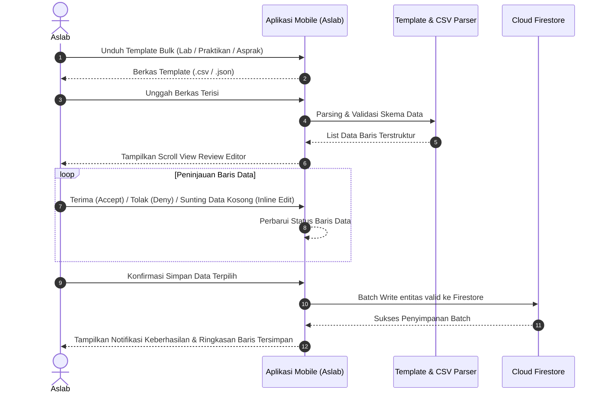
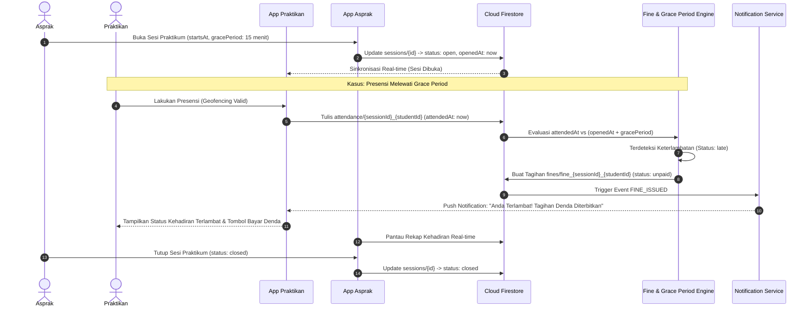
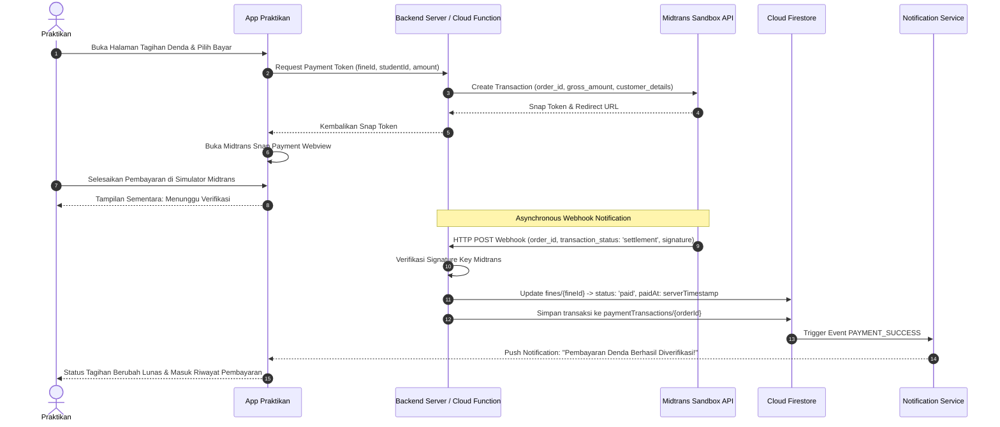
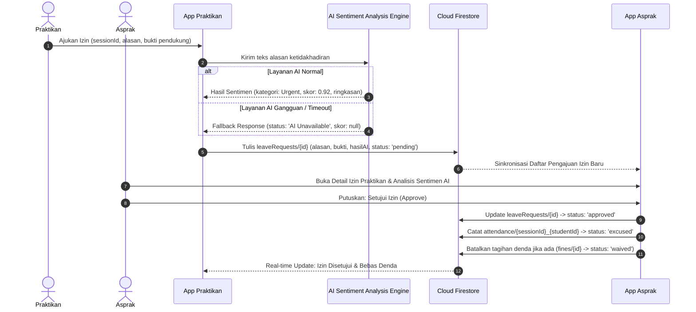

# SRS Sistem Manajemen Praktikum Sprint 4

## Dasar Penyusunan

Sprint 4 merupakan fase konsolidasi dan ekspansi fungsional lanjutan dari Sistem Manajemen Praktikum berbasis React Native dan Expo. Pada Sprint 3, sistem telah mengimplementasikan presensi berbasis geolokasi (*geofencing*), peta sebaran laboratorium interaktif (*interactive maps*), serta infrastruktur *push notification*.

Pada Sprint 4, fokus pengembangan diarahkan pada penyempurnaan manajemen laboratorium multi-peran, otomasi operasional sesi praktikum, penegakan disiplin waktu melalui sistem denda keterlambatan (*grace period*), integrasi gerbang pembayaran digital (*Payment Gateway Midtrans Sandbox*), serta integrasi kecerdasan buatan (*AI Sentiment Analysis*) pada peninjauan pengajuan izin praktikum.

Tiga pilar arsitektural utama pada Sprint 4 meliputi:
1. **Manajemen Laboratorium & Dashboard Operasional Aslab (Role Baru):** Pemisahan wewenang tingkat laboratorium (Aslab) dan tingkat kelas/sesi (Asprak). Aslab memiliki kewenangan penuh atas master laboratorium, multi-opsi *bulk insert* data (laboratorium, praktikan, dan asprak) dengan fitur *downloadable template* dan *interactive scroll-view review editor*, distribusi/pemindahan praktikan, serta *executive dashboard* untuk memantau keberlangsungan sesi dan riwayat keuangan denda.
2. **Pengelolaan Sesi Real-time Asprak, Grace Period, & Sistem Denda Otomatis:** Asprak mengelola jalannya sesi kelas (buka, pantau presensi, tutup sesi). Sistem secara otomatis mengevaluasi keterlambatan presensi terhadap batas toleransi (*grace period*) dan menerbitkan tagihan denda keterlambatan nominal tetap secara unik (*idempotent single bill*), dengan pembebasan denda bagi praktikan yang memiliki izin sah (*excused absence*).
3. **Gerbang Pembayaran Midtrans & Integrasi AI Pengajuan Izin:** Integrasi *end-to-end* pembayaran denda praktikum menggunakan Midtrans Sandbox dengan arsitektur aman *Client–Server–Payment Gateway* (termasuk verifikasi status melalui *webhook/callback* dan notifikasi pembayaran), serta integrasi model AI untuk menganalisis sentimen alasan pengajuan izin sebagai bahan pertimbangan objektif bagi Asprak dengan ketahanan sistem terhadap kegagalan layanan AI (*graceful degradation*).

Dokumen ini menjadi acuan spesifikasi kebutuhan perangkat lunak (*Software Requirements Specification*), aturan bisnis, arsitektur data Cloud Firestore, kontrak antarmuka TypeScript, hak akses multi-peran, dan kriteria penerimaan untuk Sprint 4.

---

## 1. Pendahuluan dan Ruang Lingkup

### 1.1 Tujuan

Dokumen ini mendefinisikan kebutuhan fungsional dan non-fungsional aplikasi pada Sprint 4 guna memastikan:
- Pembagian wewenang yang tegas antara Asisten Laboratorium (Aslab), Asisten Praktikum (Asprak), dan Praktikan.
- Efisiensi input data skala besar melalui fasilitas *single & bulk insert* dengan *downloadable template* dan antarmuka peninjauan interaktif.
- Penegakan aturan keterlambatan presensi yang transparan melalui mekanisme *grace period* dan tagihan denda nominal tetap.
- Transaksi pembayaran denda yang aman, terverifikasi secara server-side, dan terhubung ke Midtrans Sandbox.
- Peningkatan akurasi verifikasi izin praktikum berbantuan analisis sentimen AI dengan prinsip *human-in-the-loop*.
- Pembaruan antarmuka menyeluruh (*UI polish*) yang modern, konsisten, dan mudah digunakan pada perangkat mobile.

### 1.2 Gambaran Sistem

Sistem Manajemen Praktikum kini melayani tiga aktor utama dengan batasan hak akses yang jelas:
- **Asisten Laboratorium (Aslab):** Memiliki wewenang tingkat tinggi untuk mengonfigurasi data laboratorium (lokasi, titik koordinat, radius validasi presensi, dan batas toleransi keterlambatan/grace period), melakukan *bulk insert* (laboratorium per mata kuliah, praktikan per laboratorium, asprak per laboratorium) menggunakan berkas CSV/JSON dengan peninjau baris data dinamis (*scroll view editor*), memindahkan praktikan antar-laboratorium, serta memantau ringkasan metrik laboratorium dan riwayat keuangan hasil denda praktikum pada *Dashboard Keberlangsungan Laboratorium*.
- **Asisten Praktikum (Asprak):** Bertanggung jawab operasional di kelas praktikum tertentu. Asprak melihat daftar sesi kelasnya, membuka sesi praktikum (*open session*), memantau kehadiran praktikan secara real-time, meninjau pengajuan izin yang dilengkapi skor dan kategori analisis sentimen AI, serta menutup sesi (*close session*). Asprak tidak memiliki wewenang memodifikasi master lab atau distribusi praktikan.
- **Praktikan (`student`):** Mengikuti sesi praktikum, melakukan presensi berbasis geofencing, mengajukan izin berhalangan hadir dengan analisis AI otomatis, menerima notifikasi tagihan denda jika melakukan presensi melewati batas *grace period*, melakukan pembayaran denda via Midtrans Sandbox (Snap UI/Webview), serta memantau riwayat transaksi keuangan dan status izinnya secara real-time.

### 1.3 In Scope

- **Manajemen Laboratorium oleh Aslab:**
  - Tambah, ubah, dan hapus data laboratorium (nama lab, gedung, koordinat latitude & longitude, radius geofencing presensi, dan default grace period).
  - Tiga modul *Bulk / Single Insert* terpisah: (1) Bulk insert Laboratorium per mata kuliah, (2) Bulk insert Praktikan ke lab tertentu, (3) Bulk insert Asprak ke lab tertentu.
  - Unduhan berkas template input (*downloadable template*) berformat CSV/JSON untuk masing-masing opsi bulk insert.
  - Antarmuka *Interactive Scroll View Review Editor*: data hasil upload diuraikan menjadi baris-baris kartu interaktif yang dapat diterima (*accept*), ditolak (*deny*), atau disunting langsung nilainya (*inline edit*) sebelum dimasukkan permanen ke Cloud Firestore.
  - Fitur pemindahan praktikan (*student reassignment/transfer*) dan asprak dari satu laboratorium ke laboratorium lain tanpa mengubah jadwal sesi.
- **Dashboard Keberlangsungan Laboratorium (Aslab):**
  - Penyajian metrik akumulatif: jumlah lab aktif, total praktikan terdaftar, dan status operasional sesi (*ongoing, scheduled, closed*).
  - Monitoring jadwal praktikum yang sedang berlangsung dan jadwal mendatang secara real-time.
  - Riwayat kegiatan laboratorium dan rekapitulasi keuangan denda praktikum terkumpul.
  - Filter rentang waktu dinamis: Harian (*Day*), Mingguan (*Week*), dan Bulanan (*Month*).
- **Pengelolaan Sesi oleh Asprak:**
  - Tampilan daftar kelas, jadwal, dan sesi yang ditugaskan kepada Asprak bersangkutan.
  - Aksi pembukaan sesi praktikum (*open session*) dengan sinkronisasi instan ke seluruh praktikan.
  - Pemantauan daftar hadir praktikan secara live (*real-time attendance monitor*).
  - Aksi penutupan sesi praktikum (*close session*).
- **Perhitungan Keterlambatan & Pengelolaan Denda:**
  - Komparasi waktu presensi praktikan terhadap waktu mulai sesi praktikum ditambah durasi *grace period*.
  - Klasifikasi status kehadiran: Tepat Waktu (*On-Time*), Terlambat (*Late*), Tidak Hadir (*Absent*), dan Izin Sah (*Excused Absence*).
  - Penerbitan tagihan denda otomatis dengan nominal tetap untuk setiap insiden keterlambatan.
  - Relasi 1-to-1 antara kejadian keterlambatan dan tagihan denda (*idempotent single bill* terkait `studentId`, `sessionId`, dan `attendanceId`).
  - Pembebasan denda otomatis untuk pengajuan izin yang disetujui Asprak (*excused absence*).
  - Pembayaran denda tidak mengubah status riwayat kehadiran praktikan.
- **Integrasi Payment Gateway Midtrans Sandbox:**
  - Implementasi pola arsitektur aman *Client–Server–Payment Gateway*: client React Native meminta transaksi ke backend perantara, backend membuat transaksi via API Midtrans Sandbox menggunakan Server Key, lalu mengembalikan `snap_token` / `redirect_url`.
  - Pembayaran denda praktikan melalui antarmuka Snap Webview / Modal di aplikasi mobile.
  - Penanganan respons transaksi client dan verifikasi status mutlak melalui endpoint *Webhook/Callback Notification* dari Midtrans.
  - Siklus status pembayaran: `pending`, `success`, dan `failed`.
  - Penyimpanan riwayat pembayaran denda yang persisten di Cloud Firestore.
- **Notifikasi Terpadu Pembayaran & Denda:**
  - Notifikasi saat tagihan denda baru diterbitkan karena keterlambatan presensi.
  - Notifikasi konfirmasi ketika pembayaran denda berhasil diverifikasi.
  - Notifikasi saat pembayaran gagal atau kedaluwarsa (*expired*).
  - Layar riwayat pembayaran mandiri pada aplikasi praktikan.
- **Integrasi AI pada Pengajuan Izin Praktikum:**
  - Form pengajuan izin praktikan dengan input alasan dan dokumen pendukung.
  - Analisis sentimen otomatis terhadap teks alasan izin menggunakan API model AI (Gemini / LLM API) yang mengelompokkan sentimen (contoh: *Urgent/Genuine*, *Neutral*, *Suspicious/Weak*) beserta skor keyakinan (*confidence score*).
  - Penyimpanan hasil analisis AI berdampingan dengan dokumen `leaveRequests` di Firestore.
  - Tampilan kartu peninjauan izin bagi Asprak yang menyajikan alasan dan rekomendasi AI sebagai bahan pertimbangan (bukan penentu otomatis).
  - Penanganan *Graceful Degradation*: bila layanan AI mengalami timeout atau kegagalan koneksi, pengajuan izin tetap berhasil disimpan dan dapat diproses manual oleh Asprak dengan label status analisis *"AI Unavailable"*.
  - Persetujuan izin otomatis membebaskan denda keterlambatan dan mencatat status *Excused Absence*.

### 1.4 Out of Scope

- Pembayaran menggunakan uang riil (seluruh transaksi wajib menggunakan Midtrans Sandbox / simulator pembayaran).
- Pemindahan jadwal praktikum otomatis saat praktikan dipindahkan antar-lab (jadwal tetap mengikuti kelas induk).
- Pengambilan keputusan otomatis (*automated decision-making*) atas izin mahasiswa oleh AI tanpa persetujuan manusia (*human-in-the-loop* tetap mutlak).
- Penarikan dana (*payout/disbursement*) dari rekening kas denda praktikum ke rekening bank personal asisten.

---

## 2. Aktor dan Hak Akses (Role-Based Access Control)

| Modul / Tindakan | Praktikan (`student`) | Asprak (`asprak`) | Aslab (`aslab`) |
|---|:---:|:---:|:---:|
| Autentikasi & Profil Pengguna | Ya | Ya | Ya |
| Kelola Master Laboratorium (CRUD Lab) | Tidak | Tidak | **Ya** |
| Konfigurasi Radius Lokasi & Grace Period Lab | Tidak | Tidak | **Ya** |
| Download Berkas Template Bulk Insert | Tidak | Tidak | **Ya** |
| Eksekusi Bulk / Single Insert (Lab, Praktikan, Asprak) | Tidak | Tidak | **Ya** |
| Review & Inline Edit Data Bulk Insert (Scroll View) | Tidak | Tidak | **Ya** |
| Pindahkan Praktikan / Asprak Antar-Laboratorium | Tidak | Tidak | **Ya** |
| Akses Dashboard Keberlangsungan & Filter Periode | Tidak | Tidak | **Ya** |
| Lihat Rekap Riwayat Keuangan Denda Lab | Tidak | Tidak | **Ya** |
| Akses Sesi Kelas Tanggung Jawabnya | Tidak | **Ya** | Ya (Supervisi) |
| Buka Sesi Praktikum (*Open Session*) | Tidak | **Ya** | Tidak |
| Tutup Sesi Praktikum (*Close Session*) | Tidak | **Ya** | Tidak |
| Pantau Presensi Praktikan Real-Time | Tidak | **Ya** | Ya (Read-only) |
| Lakukan Presensi Berbasis Geofencing | **Ya** | Tidak | Tidak |
| Ajukan Izin Ketidakhadiran + Analisis AI | **Ya** | Tidak | Tidak |
| Tinjau & Putuskan Izin (Terima/Tolak) + Lihat AI | Tidak | **Ya** | Tidak |
| Lihat Tagihan Denda Keterlambatan | **Ya** | Hanya Baca di Rekap | Hanya Baca di Rekap |
| Bayar Denda via Midtrans Sandbox | **Ya** | Tidak | Tidak |
| Terima Notifikasi Denda & Pembayaran | **Ya** | Tidak | Tidak |
| Lihat Riwayat Transaksi & Pembayaran Pribadi | **Ya** | Tidak | Tidak |

---

## 3. Terminologi dan Status

| Istilah | Definisi |
|---|---|
| **Aslab (Asisten Laboratorium)** | Peran manajerial laboratorium yang bertanggung jawab mengelola master lab, bulk insert data, distribusi anggota lab, dan monitoring operasional serta kas denda. |
| **Asprak (Asisten Praktikum)** | Peran operasional praktikum yang bertugas mendampingi kelas, membuka dan menutup sesi, memantau kehadiran, serta memvalidasi pengajuan izin praktikan. |
| **Grace Period** | Rentang waktu toleransi keterlambatan (dalam menit) setelah sesi dibuka di mana praktikan yang presensi masih dikategorikan tepat waktu (*on-time*). |
| **Denda Keterlambatan (`Fine`)** | Beban biaya finansial nominal tetap yang dibebankan kepada praktikan akibat melakukan presensi di luar batas *grace period*. |
| **Excused Absence** | Status ketidakhadiran praktikan yang telah memperoleh persetujuan resmi dari Asprak, membebaskan praktikan dari denda tanpa mengubah presensi menjadi hadir. |
| **Bulk Insert Engine** | Modul impor data massal yang mengonversi berkas CSV/JSON menjadi baris-baris entitas untuk ditinjau secara visual sebelum disimpan permanen. |
| **Scroll View Review Editor** | Antarmuka interaktif yang menampilkan hasil *parse* bulk data, memungkinkan verifikator menerima, membatalkan, atau melengkapi nilai sel data yang kosong secara *inline*. |
| **Midtrans Sandbox** | Lingkungan simulasi pengujian pembayaran digital Midtrans tanpa melibatkan uang riil. |
| **Snap Token** | Token sesi transaksi terenkripsi yang diterbitkan server Midtrans untuk membuka formulir pembayaran (*payment popup/webview*). |
| **Webhook Callback** | Mekanisme pengiriman notifikasi status transaksi HTTP POST dari server Midtrans ke backend aplikasi untuk verifikasi pembayaran. |
| **AI Sentiment Analysis** | Proses evaluasi teks alasan izin praktikan menggunakan LLM untuk menentukan bobot urgensi dan sentimen pengajuan. |
| **Graceful Degradation** | Kemampuan arsitektur sistem untuk tetap beroperasi normal dan melayani pengguna meskipun subsistem eksternal (AI API) mengalami gangguan atau *timeout*. |

---

## 4. Aturan Bisnis (Business Rules)

1. **Pemisahan Wewenang Laboratorium & Kelas:**
   - Aslab mengontrol konfigurasi fisik laboratorium, radius presensi, grace period default, distribusi praktikan, dan alokasi Asprak.
   - Asprak hanya mengontrol sesi operasional kelas praktikum yang ditugaskan kepadanya. Asprak tidak dapat menambah laboratorium atau memindahkan praktikan antar-lab.
2. **Aturan Bulk Data & Isolasi Template:**
   - Tiga operasi *bulk insert* (Laboratorium, Praktikan, Asprak) beroperasi secara terpisah melalui berkas template spesifik masing-masing.
   - Seluruh baris data pada berkas template wajib divalidasi formatnya dan disajikan dalam antarmuka *Scroll View Review Editor*. Baris data yang ditolak (*denied*) oleh Aslab tidak akan dimasukkan ke Firestore. Baris data dengan field kosong wajib disunting (*inline edit*) atau ditolak sebelum eksekusi simpan permanen.
3. **Penyimpanan Bebas Perpindahan Jadwal:**
   - Pemindahan praktikan atau asprak ke laboratorium lain hanya memperbarui relasi laboratorium pada dokumen mahasiswa/asprak. Jadwal praktikum kelas induk praktikan tidak mengalami perubahan.
4. **Kalkulasi Keterlambatan Presensi:**
   - Waktu presensi sah dicatat berdasarkan `serverTimestamp` Firestore saat submit presensi berhasil.
   - Waktu ambang batas tepat waktu dihitung dengan formula:
     $$\text{WaktuToleransi} = \text{Sesi.openedAt} + (\text{Sesi.gracePeriodMinutes} \times 60\text{ detik})$$
   - Jika $\text{Presensi.attendedAt} \le \text{WaktuToleransi}$, status kehadiran adalah `on_time` dan **tidak ada denda**.
   - Jika $\text{Presensi.attendedAt} > \text{WaktuToleransi}$, status kehadiran adalah `late` dan sistem **wajib membuat 1 tagihan denda**.
5. **Integritas dan Idempotensi Tagihan Denda:**
   - Setiap insiden presensi berstatus `late` hanya boleh menerbitkan tepat satu dokumen tagihan denda dengan ID deterministik: `fine_{sessionId}_{studentId}`.
   - Tagihan memuat data relasional: `studentId`, `sessionId`, `attendanceId`, `amount` (nominal tetap terkonfigurasi), dan `status: 'unpaid'`.
   - Pelunasan tagihan denda tidak memodifikasi riwayat status kehadiran praktikan (praktikan tetap berstatus `late`).
6. **Perlakuan Khusus Izin Sah (*Excused Absence*):**
   - Pengajuan izin yang disetujui Asprak menghasilkan status kehadiran `excused`.
   - Praktikan berstatus `excused` **dibebaskan dari seluruh denda keterlambatan** pada sesi terkait. Jika tagihan denda sempat terbit, status denda dibatalkan (`waived`).
   - Persetujuan izin tidak boleh mengubah catatan kehadiran menjadi `present` / hadir fisik.
7. **Keamanan Transaksi Pembayaran (Client-Server Isolation):**
   - Kunci rahasia (*Server Key*) Midtrans Sandbox **dilarang keras** disimpan di dalam bundle kode aplikasi React Native mobile.
   - Pembuatan transaksi dan penerbitan Snap Token wajib melalui layanan backend / Cloud Functions.
   - Status pelunasan tagihan denda **tidak boleh** diperbarui hanya atas dasar klaim respons antarmuka mobile, melainkan wajib terverifikasi melalui HTTP Webhook Callback resmi dari Midtrans ke backend server.
8. **Prinsip Human-in-the-Loop pada Analisis AI:**
   - Hasil analisis sentimen AI terhadap alasan izin hanya berstatus sebagai alat bantu visual (*decision support*), bukan pemutus otomatis kelayakan izin.
   - Kegagalan pemanggilan model AI (gangguan jaringan, kuota, atau format invalid) tidak boleh memblokir pengajuan izin praktikan. Pengajuan izin tetap disimpan ke Firestore dengan status analisis AI `fallback_manual_review`.

---

## 5. Alur Interaksi Sistem (Core Sequence Flows)

### 5.1 Alur 1 — Bulk Insert & Review Editor oleh Aslab



### 5.2 Alur 2 — Pengelolaan Sesi, Presensi Grace Period, & Penerbitan Denda



### 5.3 Alur 3 — Pembayaran Denda via Midtrans Sandbox



### 5.4 Alur 4 — Pengajuan Izin Berbantuan Analisis Sentimen AI & Pembebasan Denda



---

## 6. Kebutuhan Fungsional (Functional Requirements)

### 6.1 Manajemen Laboratorium & Operasional Aslab

- **FR-01 — Manajemen Master Laboratorium & Konfigurasi:** Aslab dapat menambah, melihat, memperbarui, dan menonaktifkan data laboratorium (nama lab, gedung, koordinat latitude & bujur longitude, batas toleransi radius presensi dalam meter, dan default *grace period* dalam menit).
- **FR-02 — Bulk & Single Insert Laboratorium Berbasis Mata Kuliah:** Aslab dapat menambahkan laboratorium secara individual atau massal (*bulk*) yang dikelompokkan berdasarkan mata kuliah praktikum tertentu, dilengkapi unduhan berkas template input.
- **FR-03 — Bulk & Single Insert Praktikan ke Laboratorium:** Aslab dapat mendaftarkan mahasiswa praktikan ke laboratorium tertentu secara individual atau massal (*bulk*) menggunakan berkas CSV/JSON dengan unduhan berkas template khusus praktikan.
- **FR-04 — Bulk & Single Insert Asprak ke Laboratorium:** Aslab dapat menugaskan asisten praktikum (Asprak) ke laboratorium tertentu secara individual atau massal (*bulk*) menggunakan berkas CSV/JSON dengan unduhan berkas template khusus asprak.
- **FR-05 — Interactive Scroll View Review & Inline Editor:** Sistem menyajikan baris-baris data dari hasil *upload* berkas bulk insert ke dalam daftar kartu gulir (*scroll view*), memungkinkan Aslab melakukan verifikasi per baris (*accept / deny*), melengkapi data yang kosong secara *inline*, atau mengoreksi nilai data sebelum disimpan permanen ke Firestore.
- **FR-06 — Distribusi & Pemindahan Anggota Laboratorium:** Aslab dapat memindahkan praktikan maupun penugasan asisten (asprak/aslab) dari satu laboratorium ke laboratorium lain tanpa mengubah jadwal praktikum sesi kelas yang sedang berjalan.

### 6.2 Pengelolaan Sesi Asprak & Integrasi AI Pengajuan Izin

- **FR-07 — Pengelolaan Sesi Kelas Praktikum oleh Asprak:** Asprak dapat melihat daftar kelas dan sesi yang ditugaskan kepadanya, membuka sesi praktikum (*open session*), memantau serta mengelola kehadiran praktikan secara real-time, dan menutup sesi praktikum (*close session*) yang tersinkronisasi instan ke seluruh praktikan.
- **FR-08 — Pengajuan Izin Praktikan dengan Analisis Sentimen AI & Ketahanan Fallback:** Praktikan dapat mengajukan izin ketidakhadiran pada sesi tertentu; sistem memanggil API model AI untuk menganalisis sentimen, kategori urgensi, dan ringkasan alasan yang disimpan di Firestore, serta menerapkan *graceful degradation* agar proses izin tetap tersimpan normal (`AI Unavailable`) apabila layanan AI mengalami gangguan atau *timeout*.
- **FR-09 — Tinjauan & Keputusan Izin oleh Asprak Berbantuan AI:** Asprak dapat meninjau alasan izin praktikan beserta hasil analisis AI sebagai informasi pendukung, lalu menerima atau menolak izin secara real-time ke praktikan; izin yang disetujui mencatat status presensi `excused` (*excused absence*, bukan hadir).

### 6.3 Dashboard Keberlangsungan Laboratorium

- **FR-10 — Dashboard Monitoring Keberlangsungan Laboratorium:** Sistem menyediakan layar dashboard real-time bagi Aslab yang menampilkan jumlah laboratorium aktif, jumlah praktikan terdaftar, status kegiatan setiap lab, informasi lokasi dan waktu pelaksanaan, jadwal praktikum yang sedang berlangsung maupun yang akan datang, serta riwayat kegiatan laboratorium berdasarkan data di Firebase.
- **FR-11 — Filter Periode & Rekapitulasi Keuangan Denda:** Dashboard menyediakan filter rentang waktu (Hari, Minggu, Bulan) untuk menyaring riwayat kegiatan laboratorium serta menyajikan riwayat dan akumulasi keuangan hasil denda praktikum.

### 6.4 Perhitungan Keterlambatan, Denda, & Payment Gateway Midtrans

- **FR-12 — Mesin Evaluasi Keterlambatan & Grace Period:** Sistem membandingkan waktu presensi sah praktikan dengan waktu mulai sesi ditambah batas toleransi (*grace period*) terkonfigurasi. Presensi di dalam masa toleransi dicatat sebagai `on_time`, sedangkan setelahnya diklasifikasikan sebagai `late`.
- **FR-13 — Penerbitan Tagihan Denda Idempoten & Pembebasan Denda (*Fine Waiver*):** Sistem secara otomatis membuat tepat 1 tagihan denda nominal tetap (`fines/{fineId}`) per kejadian keterlambatan yang terhubung dengan praktikan, sesi, dan presensi. Pelunasan denda tidak mengubah status kehadiran praktikan, dan sistem secara otomatis membebaskan/membatalkan denda bagi praktikan yang memperoleh persetujuan izin (*excused absence*).
- **FR-14 — Integrasi Midtrans Client-Server & Pembuatan Snap Token:** Backend membuat transaksi ke Midtrans Sandbox API secara aman menggunakan Server Key (tanpa mengekspos *secret key* di aplikasi React Native) dan mengembalikan Snap Token / *redirect URL* ke aplikasi praktikan.
- **FR-15 — Verifikasi Webhook Callback Midtrans & Manajemen Status:** Backend menerima callback/webhook dari Midtrans Sandbox, memvalidasi signature key, dan memperbarui status tagihan denda serta transaksi menjadi `pending`, `success` (*paid*), atau `failed`.
- **FR-16 — Antarmuka Pembayaran Tagihan (Snap Checkout):** Praktikan dapat melihat daftar tagihan dan rincian nominal denda serta menyelesaikan pembayaran melalui halaman/metode Midtrans Snap Webview atau *redirect* pembayaran.
- **FR-17 — Halaman Riwayat Pembayaran Praktikan Persisten:** Praktikan dapat mengakses layar riwayat pembayaran yang menampilkan informasi sesi, tanggal tagihan, nominal, waktu transaksi, dan status pembayaran yang tetap tersedia meskipun aplikasi ditutup dan dibuka kembali.
- **FR-18 — Sistem Notifikasi Denda & Pembayaran:** Sistem mengirimkan *push notification* otomatis kepada praktikan saat tagihan denda baru dibuat, saat pembayaran berhasil diverifikasi, dan saat pembayaran gagal atau membutuhkan penyelesaian lebih lanjut.

---

## 7. Desain Antarmuka Pengguna dan State Layar

| Layar / Komponen | Peran Akses | Elemen UI Kunci & State Minimum |
|---|---|---|
| **Dashboard Laboratorium** | Aslab | Tab filter (Hari / Minggu / Bulan), kartu ringkasan (Total Lab, Total Mahasiswa, Kas Denda Masuk), *live badge* sesi berlangsung, daftar sesi praktikum hari ini, riwayat log aktivitas terbaru. |
| **Kelola Master Lab & Form** | Aslab | Daftar kartu lab, form input (Nama, Gedung, Latitude, Longitude, Radius Validasi [m], Default Grace Period [menit]), tombol simpan dan toggle status lab aktif/nonaktif. |
| **Pusat Bulk Insert Data** | Aslab | 3 Tab navigasi (Bulk Lab, Bulk Praktikan, Bulk Asprak), tombol unduh template CSV/JSON, area *drag-and-drop / file picker*, tombol parse file, pesan validasi skema file. |
| **Scroll View Review Editor** | Aslab | Ringkasan baris (Total, Valid, Invalid), daftar kartu baris data yang dapat digulir, tombol status per baris (Terima / Tolak), input teks *inline* untuk mengisi sel kosong, tombol "Simpan Baris Terpilih ke Firestore". |
| **Manajemen Anggota Lab** | Aslab | Pemilih lab asal, tabel/daftar praktikan & asprak terdaftar, modal pemindahan anggota (pilih lab tujuan, konfirmasi transfer), status konfirmasi perpindahan. |
| **Operasional Sesi Asprak** | Asprak | Daftar kelas & jadwal hari ini, kartu sesi aktif (Topik, Lab, Waktu, Grace Period), tombol "Buka Sesi" (status Scheduled), tombol "Tutup Sesi" (status Open), rekap presensi live (Hadir, Terlambat, Izin, Belum Hadir). |
| **Peninjauan Izin Asprak** | Asprak | Daftar pengajuan izin pending, kartu izin praktikan, teks alasan asli, badge sentimen AI (Urgent/Valid/Suspicious), skor keyakinan AI, tombol "Setujui (Bebaskan Denda)" dan "Tolak". |
| **Tagihan & Pembayaran Denda** | Praktikan | Kartu tagihan aktif (Nama Praktikum, Alasan Denda, Nominal Rp, Batas Waktu), tombol "Bayar Sekarang", modal/webview Midtrans Snap, indikator status verifikasi (Pending/Sukses/Gagal). |
| **Riwayat Pembayaran** | Praktikan & Aslab | Daftar kartu transaksi riwayat denda, rincian tanggal pembayaran, order ID Midtrans, nominal pelunasan, badge status lunas (*Paid*), filter sesi. |

---

## 8. Struktur Data Firestore dan Skema Dokumen

### 8.1 Koleksi `labs` (Master Laboratorium & Konfigurasi)
Path: `labs/{labId}`
```json
{
  "id": "lab_rpl",
  "name": "Laboratorium Rekayasa Perangkat Lunak",
  "courseId": "cs_ppk_2026",
  "courseName": "Praktikum Pemrograman Komputer",
  "building": "Gedung Informatika Lt. 2",
  "latitude": -7.765432,
  "longitude": 110.372101,
  "radiusMeters": 50,
  "defaultGracePeriodMinutes": 15,
  "defaultFineAmount": 20000,
  "isActive": true,
  "createdAt": "serverTimestamp",
  "updatedAt": "serverTimestamp",
  "managedBy": "uid_aslab_01"
}
```

### 8.2 Koleksi `sessions` (Diperbarui dengan Atribut Grace Period & Denda)
Path: `sessions/{sessionId}`
```json
{
  "classId": "class_ppk_a",
  "title": "Praktikum 4: Integrasi Midtrans & AI",
  "labId": "lab_rpl",
  "locationName": "Laboratorium Rekayasa Perangkat Lunak",
  "latitude": -7.765432,
  "longitude": 110.372101,
  "radiusMeters": 50,
  "gracePeriodMinutes": 15,
  "fineAmount": 20000,
  "startsAt": "2026-11-25T08:00:00Z",
  "endsAt": "2026-11-25T10:00:00Z",
  "status": "open",
  "openedBy": "uid_asprak_01",
  "openedAt": "2026-11-25T08:00:05Z",
  "closedBy": null,
  "closedAt": null,
  "updatedAt": "serverTimestamp"
}
```

### 8.3 Koleksi `attendance` (Diperkaya Atribut Keterlambatan)
Path: `attendance/{sessionId}_{studentId}`
```json
{
  "sessionId": "session_001",
  "classId": "class_ppk_a",
  "studentId": "uid_mahasiswa_01",
  "studentName": "Al Programmer",
  "studentIdentifier": "22/123456/PA/12345",
  "attendedAt": "2026-11-25T08:22:10Z",
  "latitude": -7.765410,
  "longitude": 110.372115,
  "distanceMeters": 14.2,
  "isWithinRadius": true,
  "attendanceStatus": "late",
  "minutesLate": 7,
  "fineId": "fine_session_001_uid_mahasiswa_01"
}
```

### 8.4 Koleksi `fines` (Tagihan Denda Keterlambatan)
Path: `fines/{fineId}`
```json
{
  "id": "fine_session_001_uid_mahasiswa_01",
  "sessionId": "session_001",
  "sessionTitle": "Praktikum 4: Integrasi Midtrans & AI",
  "studentId": "uid_mahasiswa_01",
  "studentName": "Al Programmer",
  "studentIdentifier": "22/123456/PA/12345",
  "attendanceId": "session_001_uid_mahasiswa_01",
  "amount": 20000,
  "minutesLate": 7,
  "status": "unpaid",
  "issuedAt": "serverTimestamp",
  "paidAt": null,
  "transactionId": null,
  "isWaived": false,
  "waiveReason": null
}
```

### 8.5 Koleksi `paymentTransactions` (Log Transaksi Midtrans)
Path: `paymentTransactions/{orderId}`
```json
{
  "orderId": "TRX-FINE-1732535000-01",
  "fineId": "fine_session_001_uid_mahasiswa_01",
  "studentId": "uid_mahasiswa_01",
  "grossAmount": 20000,
  "paymentType": "bank_transfer",
  "transactionStatus": "settlement",
  "snapToken": "snap_token_sandbox_abcdef123456",
  "redirectUrl": "https://app.sandbox.midtrans.com/snap/v2/vtweb/abcdef123456",
  "fraudStatus": "accept",
  "rawCallback": { "status_code": "200", "transaction_id": "midtrans_tx_998877" },
  "createdAt": "serverTimestamp",
  "updatedAt": "serverTimestamp"
}
```

### 8.6 Koleksi `leaveRequests` (Diperkaya Analisis Sentimen AI)
Path: `leaveRequests/{leaveId}`
```json
{
  "id": "leave_001",
  "sessionId": "session_001",
  "studentId": "uid_mahasiswa_01",
  "studentName": "Al Programmer",
  "reason": "Mohon izin tidak dapat hadir praktikum karena sakit tifus dan dirawat di RS Sardjito.",
  "documentUrl": "https://storage.googleapis.com/.../surat_dokter.pdf",
  "status": "approved",
  "aiAnalysis": {
    "status": "completed",
    "sentiment": "urgent_medical",
    "confidenceScore": 0.94,
    "summary": "Mahasiswa menyertakan alasan medis darurat (rawat inap rumah sakit).",
    "recommendation": "recommend_approval"
  },
  "reviewedBy": "uid_asprak_01",
  "reviewedAt": "serverTimestamp",
  "reviewNotes": "Surat dokter valid, izin diterima dan denda dibebaskan.",
  "createdAt": "serverTimestamp"
}
```

---

## 9. Aturan Keamanan Firestore (Security Rules Minimum Sprint 4)

1. **Koleksi `labs`:**
   - Read terbuka untuk semua pengguna terotentikasi.
   - Create, Update, Delete hanya diizinkan untuk peran `aslab`.
2. **Koleksi `fines`:**
   - Praktikan hanya dapat membaca dokumen denda miliknya (`studentId == request.auth.uid`).
   - Aslab dan Asprak dapat membaca seluruh denda untuk keperluan rekapitulasi dashboard dan kelas.
   - Modifikasi status pembayaran (`status = 'paid'`) hanya dapat dilakukan oleh proses backend terotentikasi (Firebase Admin SDK).
3. **Koleksi `paymentTransactions`:**
   - Mahasiswa hanya berhak membaca data transaksi miliknya sendiri.
   - Pembuatan dan pembaruan transaksi dilakukan secara eksklusif oleh backend terotentikasi.
4. **Koleksi `leaveRequests`:**
   - Praktikan berhak membuat pengajuan izin untuk dirinya sendiri.
   - Asprak kelas berhak memperbarui status persetujuan (`status: 'approved' | 'rejected'`) dan catatan peninjauan.

---

## 10. Kebutuhan Nonfungsional (Non-Functional Requirements)

- **NFR-01 Keamanan Kunci Pembayaran (Payment Security):** Kunci rahasia Midtrans Server Key tidak boleh terekspos di sisi klien React Native; seluruh pembuatan transaksi dan verifikasi signature dijalankan pada backend terisolasi.
- **NFR-02 Kinerja Bulk Upload & Parsing:** Sistem mampu mem-parsing dan me-render hingga 500 baris data CSV/JSON dalam antarmuka Scroll View Review Editor dalam waktu kurang dari 2 detik tanpa *UI freezing*.
- **NFR-03 Ketahanan Kegagalan AI (Fault Tolerance & Availability):** Kegagalan atau keterlambatan respon model AI (> 5 detik) secara otomatis mengaktifkan mekanisme *fallback* manual sehingga praktikan tetap berhasil mengirim izin.
- **NFR-04 Sinkronisasi Data Real-Time:** Perubahan status sesi (buka/tutup) dan pembaruan status pembayaran Midtrans tersinkronisasi ke antarmuka pengguna dalam waktu maksimal 2 detik melalui Firestore Realtime Listener.
- **NFR-05 Integritas Transaksi Idempoten:** Pengiriman ulang webhook Midtrans (retry delivery) tidak menyebabkan duplikasi pencatatan pembayaran atau perubahan saldo kas denda ganda.
- **NFR-06 Finalisasi & Konsistensi Antarmuka (UI/UX Polish):** Seluruh layar pada peran Aslab, Asprak, dan Praktikan menerapkan sistem desain visual yang seragam, modern, responsif, dan ramah pengguna (termasuk penanganan *loading state*, *empty state*, dan *error feedback*).
- **NFR-07 Persistensi Riwayat Pembayaran:** Data riwayat tagihan dan transaksi pembayaran tetap tersedia dan dapat diakses kembali oleh praktikan meskipun aplikasi ditutup sepenuhnya dan dibuka ulang.

---

## 11. Traceability dan Pembagian Modul Kerja

Sprint 4 dipimpin oleh **Galang sebagai Project Manager (PM)** yang mengoordinasikan arsitektur data global, kontrak antarmuka TypeScript, konfigurasi server Midtrans & AI, serta pengujian sistem tanpa menulis kode fitur.

Pekerjaan teknis dibagi secara adil dan proporsional kepada dua programmer independen: **Abhi** (9 FR) dan **Al** (9 FR), dengan pembagian domain fungsional yang bebas dependensi:
- **Abhi:** Domain Manajemen Laboratorium Aslab, Bulk Insert & Review Engine, Operasional Sesi Asprak, serta Integrasi AI & Pengajuan Izin.
- **Al:** Domain Dashboard Keberlangsungan Laboratorium, Perhitungan Keterlambatan Grace Period, Tagihan & Pembebasan Denda, Integrasi Midtrans Payment Gateway, serta Push Notification & Riwayat Pembayaran.

| Kode FR | Deskripsi Kebutuhan | Penanggung Jawab Utama | Sifat Modul & Tanggung Jawab |
|---|---|:---:|---|
| **FR-01** | Master Laboratorium & Konfigurasi (Radius/Grace Period) | **Abhi** | Aslab Feature & Firestore `labs` CRUD |
| **FR-02** | Bulk/Single Insert Lab per Mata Kuliah + Template | **Abhi** | Course-Lab Bulk Parser & Downloadable Template |
| **FR-03** | Bulk/Single Insert Praktikan ke Lab + Template | **Abhi** | Student Bulk Parser & Downloadable Template |
| **FR-04** | Bulk/Single Insert Asprak ke Lab + Template | **Abhi** | Asprak Bulk Parser & Downloadable Template |
| **FR-05** | Interactive Scroll View Review & Inline Editor | **Abhi** | Data Review UI, Row Accept/Deny, & Inline Edit |
| **FR-06** | Distribusi & Pemindahan Anggota Lab | **Abhi** | Student/Asprak/Aslab Reassignment Service |
| **FR-07** | Pengelolaan Sesi Kelas Praktikum oleh Asprak | **Abhi** | Asprak Session Screen, Live Attendance, & Close Session |
| **FR-08** | Pengajuan Izin Praktikan, Analisis Sentimen AI, & Fallback | **Abhi** | Leave Form, AI Sentiment API, & Graceful Degradation |
| **FR-09** | Tinjauan & Keputusan Izin Asprak Berbantuan AI | **Abhi** | Asprak AI Decision Support & Excused Absence Status |
| **FR-10** | Dashboard Monitoring Keberlangsungan Laboratorium | **Al** | Aslab Dashboard UI, Metrics, Ongoing/Upcoming, & Logs |
| **FR-11** | Filter Periode Dashboard & Rekapitulasi Keuangan Denda | **Al** | Day/Week/Month Time Filter & Fine Financial Summary |
| **FR-12** | Mesin Evaluasi Keterlambatan & Grace Period | **Al** | Attendance Timing Engine & Grace Period Evaluator |
| **FR-13** | Penerbitan Tagihan Denda Idempoten & Pembebasan Denda | **Al** | Fine Billing Generator, `fines` Service, & Fine Waiver |
| **FR-14** | Integrasi Midtrans Client-Server & Snap Token | **Al** | Backend Snap Generator & Secure Server Key Isolation |
| **FR-15** | Verifikasi Webhook Callback Midtrans & Status | **Al** | Webhook Notification Handler & Signature Verification |
| **FR-16** | Antarmuka Pembayaran Tagihan (Snap Checkout) | **Al** | Student Billing List & Midtrans Snap Webview Checkout |
| **FR-17** | Halaman Riwayat Pembayaran Praktikan Persisten | **Al** | Persistent Payment History Screen & Transaction Log |
| **FR-18** | Sistem Notifikasi Denda & Pembayaran | **Al** | Event Push Notification (Fine Issued, Success, Failed) |

---

## 12. Kriteria Penerimaan Sprint (Acceptance Criteria)

1. **Master Lab & Konfigurasi:** Aslab berhasil membuat data lab lengkap dengan radius geofencing dan konfigurasi grace period menit yang tersimpan di Firestore.
2. **Bulk Insert dengan 3 Template Terpisah:** Berkas template CSV/JSON untuk Lab, Praktikan, dan Asprak dapat diunduh, diisi, diunggah, dan ditampilkan dalam antarmuka Scroll View Review Editor.
3. **Penyuntingan Baris Bulk Data:** Aslab dapat menerima baris valid, menolak baris invalid, dan melengkapi data kosong secara *inline* sebelum data disimpan massal ke database.
4. **Pemindahan Praktikan & Asprak:** Praktikan dan Asprak dapat dipindahkan ke laboratorium lain tanpa mengubah jadwal sesi praktikum kelas induk.
5. **Dashboard Aslab Berfilter:** Dashboard menampilkan total lab, total praktikan, sesi aktif, serta visualisasi kas denda dengan filter Harian, Mingguan, dan Bulanan yang berfungsi akurat.
6. **Operasional Sesi Asprak:** Asprak dapat membuka sesi kelas, melihat pembaruan presensi praktikan secara real-time, dan menutup sesi dengan sinkronisasi status langsung ke aplikasi praktikan.
7. **Deteksi Grace Period:** Praktikan yang presensi dalam masa toleransi tercatat tepat waktu tanpa denda; praktikan yang presensi melewati batas toleransi otomatis memperoleh status terlambat dan diterbitkan 1 tagihan denda nominal tetap.
8. **Pembayaran Midtrans Sandbox:** Praktikan dapat membuka Snap Webview dari tagihan denda, menyelesaikan pembayaran di simulator Midtrans Sandbox, dan status tagihan berubah menjadi `paid` setelah webhook diverifikasi server.
9. **Notifikasi Pembayaran:** Praktikan menerima notifikasi otomatis saat denda terbit, pembayaran berhasil, dan pembayaran gagal/kedaluwarsa.
10. **Analisis AI pada Pengajuan Izin:** Alasan pengajuan izin praktikan dianalisis oleh AI dengan tampilan sentimen pada layar Asprak. Jika AI offline, pengajuan tetap berhasil dikirim.
11. **Pembebasan Denda Izin Sah:** Izin praktikan yang disetujui Asprak otomatis berstatus *excused absence* dan tagihan denda keterlambatan pada sesi tersebut dibebaskan/dibatalkan.
12. **Kualitas Kode:** Lolos linting (`npx expo lint`) dan typechecking (`npx tsc --noEmit`) tanpa error.

---

## 13. Skenario Demonstrasi Akhir

### Demo 1 — Manajemen Aslab & Bulk Insert Review
1. Aslab login dan mengunduh berkas template CSV Bulk Praktikan.
2. Aslab mengunggah berkas yang memuat data praktikan (sebagian sengaja dikosongkan nomor mahasiswanya).
3. Scroll View Review Editor menampilkan data: Aslab menerima 5 baris data, menolak 1 baris tidak valid, dan mengisi data nomor mahasiswa yang kosong secara *inline*.
4. Aslab menekan simpan: seluruh data yang diterima berhasil dicatat ke koleksi Firestore.
5. Aslab memindahkan salah satu praktikan ke laboratorium lain dan memverifikasi perubahan lab pada profil praktikan.

### Demo 2 — Operasional Sesi, Grace Period, & Pembayaran Denda Midtrans
1. Asprak membuka sesi praktikum dengan grace period 10 menit dan denda Rp20.000.
2. Praktikan A presensi pada menit ke-5: berstatus `on_time` dan bebas denda.
3. Praktikan B presensi pada menit ke-15: sistem mencatat `late` dan menerbitkan notifikasi tagihan denda Rp20.000.
4. Praktikan B membuka tagihan denda, menekan tombol "Bayar", dan menyelesaikan transaksi melalui Midtrans Sandbox Simulator.
5. Webhook Midtrans memverifikasi transaksi, status denda berubah menjadi `paid`, notifikasi pembayaran sukses terkirim, dan transaksi tercatat di Riwayat Pembayaran.
6. Aslab membuka Dashboard: nominal denda Rp20.000 tercatat pada rekapitulasi keuangan.

### Demo 3 — Pengajuan Izin Berbantuan AI & Pembebasan Denda
1. Praktikan C berhalangan hadir dan mengajukan izin dengan alasan medis darurat.
2. Sistem menganalisis alasan melalui AI, menghasilkan sentimen *urgent_medical* dengan skor keyakinan tinggi.
3. Asprak membuka daftar izin, melihat alasan dan badge analisis AI, lalu menyetujui permohonan izin.
4. Status kehadiran Praktikan C otomatis tercatat sebagai `excused` dan sistem membebaskan tagihan denda keterlambatan sesi tersebut.

---

## 14. Referensi Teknis

| Pustaka / Layanan | Tautan Dokumentasi Resmi |
|---|---|
| **Midtrans Snap Docs** | https://docs.midtrans.com/reference/snap-basics |
| **Midtrans Webhook HTTP Notification** | https://docs.midtrans.com/reference/handling-notifications |
| **Google Gemini API / LLM SDK** | https://ai.google.dev/docs |
| **Expo Document Picker** | https://docs.expo.dev/versions/latest/sdk/document-picker/ |
| **Expo File System & Sharing** | https://docs.expo.dev/versions/latest/sdk/filesystem/ |
| **Cloud Firestore Batch Writes** | https://firebase.google.com/docs/firestore/manage-data/transactions-and-batched-writes |
| **Expo Notifications SDK 58** | https://docs.expo.dev/versions/latest/sdk/notifications/ |
