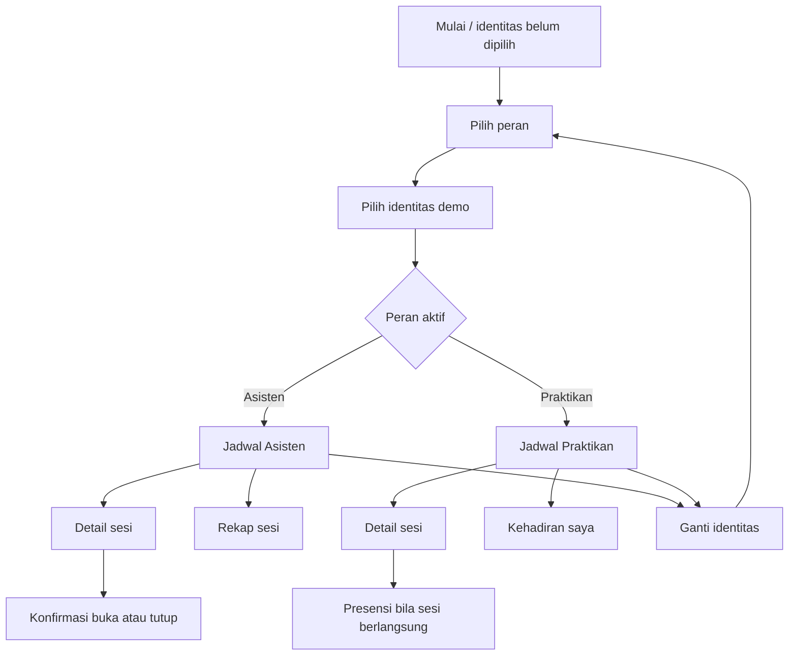

# Design Mockup Interaktif — Manajemen Praktikum

> Spesifikasi visual dan perilaku layar untuk Sprint 1. Dokumen ini adalah mockup tekstual yang siap dijadikan acuan implementasi; bukan prototipe yang bisa diklik.

## 1. Tujuan dan batas desain

Aplikasi membantu dua aktor menjalankan alur praktikum: Asisten mengelola status sesi dan melihat rekap demo; Praktikan melihat jadwal, mencatat presensi ketika sesi berlangsung, dan membuka riwayat pribadinya. Semua isi dan perubahan adalah dummy dalam state aplikasi selama aplikasi berjalan.

| Termasuk | Tidak termasuk |
|---|---|
| Pilih peran dan identitas demo, jadwal/detail, buka/tutup sesi, presensi, rekap dan riwayat | API, database, autentikasi nyata, sinkronisasi antarperan/perangkat, persistensi setelah aplikasi ditutup, notifikasi, QR, lokasi, ekspor |

Fokusnya adalah layar portrait Android/iOS. Expo Router mengatur perpindahan antarlayar; rancangan ini tidak menetapkan implementasi API tertentu. Versi baseline saat ini: Expo `~58.0.19`, Expo Router `~58.0.24`, React Native `0.88.0`.

## 2. Arah visual dan token

### 2.1 Prinsip

- **Monokrom penuh:** gunakan hitam, putih, dan abu-abu untuk seluruh elemen, termasuk status. Jangan mengandalkan rona warna untuk menyampaikan makna.
- **Hierarki melalui bentuk dan teks:** judul lebih besar dan tegas; metadata lebih kecil; status selalu berupa label teks dengan ikon yang sesuai.
- **Latar tenang, konten terbaca:** pisahkan bagian dengan ruang, garis tipis, dan perbedaan tingkat abu-abu. Hindari bayangan dekoratif, gradien, dan ikon emoji.
- **Aksi jelas:** tombol utama berupa bidang hitam/putih kontras sesuai tema; aksi sekunder berupa outline atau teks. Selalu tampilkan state nonaktif dan alasannya.

### 2.2 Token warna

| Peran token | Terang | Gelap | Penggunaan |
|---|---|---|---|
| `background` | `#F7F7F7` | `#111111` | Latar halaman |
| `surface` | `#FFFFFF` | `#1C1C1C` | Kartu, modal, bidang input |
| `surfaceMuted` | `#EEEEEE` | `#292929` | Kartu terpilih, chip netral, area sekunder |
| `textPrimary` | `#171717` | `#F5F5F5` | Judul, isi utama |
| `textSecondary` | `#555555` | `#C2C2C2` | Keterangan, waktu, petunjuk |
| `border` | `#D2D2D2` | `#414141` | Garis pemisah dan outline |
| `actionPrimary` | `#171717` | `#F5F5F5` | Tombol utama dengan label terbalik |
| `actionSecondary` | `#FFFFFF` | `#1C1C1C` | Tombol sekunder dengan outline |
| `disabledSurface` | `#E5E5E5` | `#303030` | Kontrol nonaktif |
| `disabledText` | `#555555` | `#B5B5B5` | Label nonaktif; tetap terbaca |

Teks biasa memakai pasangan foreground/background dengan rasio kontras minimum 4.5:1. Status tidak dibuat pudar sampai sulit dibaca. Untuk aksesibilitas, badge status menggunakan ikon dan label, misalnya `◷ Belum dibuka`, `● Berlangsung`, `✓ Selesai`; bentuk ikon pada implementasi memakai satu keluarga ikon outline yang konsisten, bukan glyph teks ini.

### 2.3 Tipografi, ruang, dan komponen

| Elemen | Ukuran/aturan |
|---|---|
| Judul layar | 24/30 pt, semibold |
| Judul bagian/kartu | 18/24 pt, semibold |
| Isi utama | 16/24 pt, regular |
| Label dan metadata | 14/20 pt, regular; jangan gunakan teks penting di bawah 14 pt |
| Caption tambahan | 12/16 pt; untuk informasi non-esensial saja |
| Spasi | Skala 4, 8, 12, 16, 24, 32 pt; jarak antarkontrol minimal 8 pt |
| Radius | 12 pt untuk kartu dan dialog; 8 pt untuk input dan badge |
| Target sentuh | Minimal 44×44 pt iOS dan 48×48 dp Android |
| Ikon | Outline monokrom 18–22 pt; ikon aksi selalu ditemani label aksesibel |

Gunakan font sistem agar tampil konsisten dan tidak membutuhkan aset/font tambahan. Gunakan angka tabular untuk waktu dan nomor identitas jika tersedia. Layout menggunakan Flexbox, inset aman, dan konten gulir vertikal; tidak ada lebar tetap yang menyebabkan layar kecil bergulir horizontal.

## 3. Navigasi dan struktur layar

### 3.1 Alur umum



### 3.2 Tab per peran

- **Asisten:** `Jadwal` dan `Rekap`.
- **Praktikan:** `Jadwal` dan `Kehadiran saya`.
- Detail sesi dibuka sebagai layar di atas tab aktif; tombol kembali mengembalikan pengguna ke tab dan posisi daftar sebelumnya.
- Header memuat nama produk **Praktikum**, konteks peran, serta kontrol `Ganti identitas` yang membuka pemilih peran/identitas. Tampilkan nama identitas aktif agar konteks demo selalu jelas.
- Jika state identitas kosong, arahkan ke pemilih identitas sebelum layar peran; jangan tampilkan aksi yang membutuhkan identitas.

## 4. Mockup layar

Wireframe di bawah menunjukkan susunan relatif, bukan ukuran piksel persis. Konten halaman dapat digulir; tombol aksi utama pada detail sesi tetap mudah dijangkau dan tidak menutupi konten.

### 4.1 Pilih peran dan identitas — FR-01

```text
┌────────────────────────────────┐
│ Praktikum                 1 / 2 │
│                                │
│ Siapa yang menggunakan demo?   │
│ Pilih peran, lalu identitas.   │
│                                │
│ PERAN                          │
│ [ Asisten ]     [ Praktikan ]  │
│                                │
│ IDENTITAS PRAKTIKAN            │
│ ( ) Nadia Putri                │
│     23.11.0123                 │
│ ( ) Rafi Pratama               │
│     23.11.0147                 │
│                                │
│ [ Lanjutkan ]                  │
│ Demo lokal · perubahan tidak   │
│ disimpan setelah aplikasi tutup│
└────────────────────────────────┘
```

- Peran wajib dipilih sebelum daftar identitas muncul. Pilihan peran mengubah daftar identitas menjadi Asisten atau Praktikan.
- Pilih satu identitas melalui baris radio yang seluruh barisnya dapat disentuh. `Lanjutkan` nonaktif sampai peran dan identitas terpilih.
- Saat tombol ditekan, simpan pilihan di state runtime dan buka jadwal sesuai peran. Tampilkan ringkasan peran/nama di header.
- `Ganti identitas` membuka layar ini dengan pilihan aktif terpilih. Mengganti peran mengganti konteks halaman; data demo rekap dan riwayat boleh tetap terpisah sesuai SRS.

### 4.2 Jadwal — FR-02, FR-03

```text
┌────────────────────────────────┐
│ Praktikum               [Nadia⌄]│
│ Jadwal                         │
│ Selasa, 27 Oktober 2026        │
│                                │
│ SELASA · 27 OKTOBER            │
│ ┌────────────────────────────┐ │
│ │ Basis Data                 │ │
│ │ ● Berlangsung              │ │
│ │ Kelas B · Lab Komputer 2   │ │
│ │ 13.00–15.00                │ │
│ │ Lihat detail           ›   │ │
│ └────────────────────────────┘ │
│                                │
│ BERIKUTNYA                     │
│ ┌────────────────────────────┐ │
│ │ Dasar Pemrograman           │ │
│ │ ◷ Belum dibuka              │ │
│ │ Kelas A · Lab RPL 1         │ │
│ │ 28 Okt · 08.00–10.00        │ │
│ │ Lihat detail           ›   │ │
│ └────────────────────────────┘ │
│                                │
│ [Jadwal]       [Kehadiran saya]│
└────────────────────────────────┘
```

Di tab Asisten, tab kedua berlabel `Rekap`. Setiap baris sesi menampilkan nama praktikum, kelas/lab, tanggal dan rentang waktu, serta status eksplisit. Seluruh kartu/baris membuka detail sesi. Tidak ada filter atau fungsi tambahan yang berada di luar kebutuhan Sprint 1.

**Jadwal kosong:** tampilkan judul `Belum ada jadwal`, teks `Jadwal praktikum demo akan muncul di sini.`, serta navigasi peran yang tetap tersedia. Jangan tampilkan daftar kosong tanpa penjelasan.

### 4.3 Detail sesi — FR-04 hingga FR-07

```text
┌────────────────────────────────┐
│ ‹ Jadwal                       │
│ Detail sesi                    │
│ Basis Data                     │
│ ● BERLANGSUNG                  │
│                                │
│ Kelas        Kelas B           │
│ Lokasi       Lab Komputer 2    │
│ Tanggal      27 Okt 2026       │
│ Waktu        13.00–15.00       │
│                                │
│ ASISTEN                        │
│ [ Tutup sesi ]                 │
│                                │
│ Praktikan: tombol presensi     │
│ [ Hadir sekarang ]             │
│ Belum tercatat untuk sesi ini. │
└────────────────────────────────┘
```

Perlihatkan hanya kontrol yang sah untuk peran aktif:

| Peran dan status | Kontrol dan respons |
|---|---|
| Asisten + `Belum dibuka` | `Buka sesi`; tekan membuka konfirmasi. Setelah disetujui status menjadi `Berlangsung` pada detail dan jadwal. |
| Asisten + `Berlangsung` | `Tutup sesi`; tekan membuka konfirmasi. Setelah disetujui status menjadi `Selesai` pada detail dan jadwal. |
| Asisten + `Selesai` | Tampilkan status dan waktu sesi; tidak ada tombol buka/tutup. |
| Praktikan + `Belum dibuka` | Tombol `Presensi belum tersedia` nonaktif; alasan terlihat: `Presensi aktif setelah sesi dibuka oleh Asisten.` |
| Praktikan + `Berlangsung`, belum hadir | Tombol `Hadir sekarang` aktif. Sesudah ditekan, catat waktu lokal, tampilkan feedback sukses, dan ubah area menjadi `✓ Hadir · 13.02`. |
| Praktikan + `Berlangsung`, sudah hadir | Tampilkan waktu catatan pertama dan tombol nonaktif; teks `Presensi sudah tercatat untuk sesi ini.` Waktu pertama tidak berubah. |
| Praktikan + `Selesai` | Tombol nonaktif; alasan terlihat: `Sesi telah selesai. Presensi baru tidak dapat dicatat.` |

Konfirmasi buka: `Buka sesi sekarang?` dengan `Batal` dan `Buka sesi`. Konfirmasi tutup: `Tutup sesi? Praktikan tidak dapat melakukan presensi baru setelah sesi selesai.` dengan `Batal` dan `Tutup sesi`. Batal menutup dialog tanpa mengubah state. Setelah konfirmasi, dialog tutup, status dan teks aksi diperbarui, lalu tampilkan umpan balik ringkas.

Jika percobaan presensi kedua terjadi, pertahankan catatan pertama dan waktunya; tampilkan informasi `Presensi Anda sudah tercatat pada 13.02.` Jika aksi tidak sah karena status bukan `Berlangsung`, jangan membuat catatan dan tampilkan alasan yang sama dengan status yang terlihat di layar.

### 4.4 Rekap sesi Asisten — FR-08

```text
┌────────────────────────────────┐
│ ‹ Jadwal                       │
│ Rekap presensi                 │
│ Basis Data · Kelas B           │
│ 27 Okt 2026 · 13.00–15.00       │
│ ● Berlangsung                  │
│                                │
│ 2 praktikan hadir               │
│ ────────────────────────────── │
│ Nadia Putri      13.02         │
│ 23.11.0123                     │
│ ────────────────────────────── │
│ Rafi Pratama     13.08         │
│ 23.11.0147                     │
└────────────────────────────────┘
```

Daftar diurutkan berdasarkan waktu hadir paling awal ke paling akhir. Identitas, nomor mahasiswa, dan waktu lokal ditampilkan sebagai teks. Jumlah hadir berasal dari jumlah baris yang ditampilkan. Rekap merupakan dataset demo milik Asisten dan tidak dijanjikan sama dengan riwayat Praktikan.

**Rekap kosong:** judul `Belum ada presensi`, teks `Presensi praktikan akan muncul di sini setelah dicatat.` Jumlah ditampilkan sebagai `0 praktikan hadir`; jangan menyembunyikan konteks sesi.

### 4.5 Kehadiran saya — FR-09

```text
┌────────────────────────────────┐
│ Praktikum               [Nadia⌄]│
│ Kehadiran saya                 │
│ Nadia Putri · 23.11.0123       │
│                                │
│ ┌────────────────────────────┐ │
│ │ Basis Data                 │ │
│ │ Kelas B · Lab Komputer 2   │ │
│ │ 27 Okt 2026 · 13.02         │ │
│ │ ✓ Hadir                    │ │
│ └────────────────────────────┘ │
│                                │
│ [Jadwal]       [Kehadiran saya]│
└────────────────────────────────┘
```

Riwayat hanya memuat catatan untuk identitas Praktikan aktif, diurutkan paling baru dahulu. Setiap item memuat sesi, kelas/lab, tanggal dan waktu hadir, serta label `Hadir`. Item dapat membuka detail sesi bila sesi itu masih tersedia di jadwal.

**Riwayat kosong:** tampilkan `Belum ada kehadiran`, teks `Presensi yang Anda catat akan tampil di sini.`, dan kontrol `Lihat jadwal` yang membuka tab Jadwal.

## 5. Data dummy contoh

Gunakan data fiktif yang sama untuk memperagakan layar. Kumpulan rekap Asisten dan riwayat Praktikan adalah contoh lokal terpisah; bila keduanya kebetulan memuat Nadia pada sesi Basis Data, hal itu bukan bukti sinkronisasi.

| Sesi | Kelas/lab | Waktu | Status awal |
|---|---|---|---|
| Dasar Pemrograman | Kelas A · Lab RPL 1 | 28 Okt 2026, 08.00–10.00 | Belum dibuka |
| Basis Data | Kelas B · Lab Komputer 2 | 27 Okt 2026, 13.00–15.00 | Berlangsung |
| Jaringan Komputer | Kelas A · Lab Jaringan | 26 Okt 2026, 09.00–11.00 | Selesai |

| Praktikan demo | NIM |
|---|---|
| Nadia Putri | 23.11.0123 |
| Rafi Pratama | 23.11.0147 |

Rekap demo Basis Data: Nadia pukul 13.02, Rafi pukul 13.08; jumlah yang ditampilkan adalah 2. Contoh riwayat Nadia: Basis Data pukul 13.02. Waktu pada contoh adalah ilustrasi waktu lokal perangkat, bukan waktu server.

## 6. Kontrak interaksi

| Pemicu | Respons yang terlihat | Perubahan state |
|---|---|---|
| Pengguna memilih peran | Pilihan terpilih terlihat; daftar identitas sesuai peran muncul | Peran aktif di form pemilihan |
| Pengguna memilih identitas lalu `Lanjutkan` | Jadwal peran terpilih terbuka dan identitas muncul di header | `activeRole` dan `activeIdentity` terset |
| Buka detail dari kartu jadwal | Detail menampilkan status sesi terkini dan aksi sesuai peran | Tidak ada perubahan data |
| Asisten menekan `Buka sesi` lalu mengonfirmasi | Dialog hilang; status di detail/jadwal berubah ke `Berlangsung` | `Belum dibuka → Berlangsung` |
| Asisten membatalkan dialog buka | Kembali ke detail; status tetap | Tidak berubah |
| Asisten menekan `Tutup sesi` lalu mengonfirmasi | Dialog hilang; status di detail/jadwal berubah ke `Selesai`; presensi baru dinonaktifkan | `Berlangsung → Selesai` |
| Asisten membatalkan dialog tutup | Kembali ke detail; sesi tetap berlangsung | Tidak berubah |
| Praktikan menekan `Hadir sekarang` saat berlangsung | Waktu lokal dan feedback sukses tampil; riwayat diperbarui | Tambah satu catatan untuk pasangan identitas+sesi |
| Praktikan mencoba presensi kedua | Informasi duplikat tampil; waktu pertama tetap terlihat | Tidak menambah/mengubah catatan pertama |
| Praktikan mencoba presensi saat sesi belum dibuka/selesai | Kontrol nonaktif dan alasan tampil di dekat kontrol | Tidak ada catatan baru |
| Pengguna membuka tab Rekap/Kehadiran saya | Daftar atau empty state yang sesuai tampil | Tidak ada perubahan data |
| Pengguna memilih `Ganti identitas` | Pemilih dibuka dengan peran/identitas aktif terlihat | State berubah hanya setelah pilihan dikonfirmasi melalui `Lanjutkan` |

**Aturan state:** status sesi tunggal menjadi sumber kebenaran bagi kartu jadwal dan detail pada sesi yang sama. Identitas Praktikan + ID sesi menjadi kunci unik catatan presensi. Waktu dicatat satu kali ketika aksi diterima. Seluruh state hidup hanya selama aplikasi belum ditutup/reload; jangan menampilkan klaim tersimpan permanen.

## 7. Pemetaan layar terhadap kebutuhan

| Kebutuhan | Bagian desain |
|---|---|
| FR-01 — Peran dan identitas dummy | §3.1, §4.1 |
| FR-02 — Navigasi dan layout mobile | §2.3, §3 |
| FR-03 — Jadwal dan empty state | §4.2 |
| FR-04 — Detail dan status terkini | §4.3 |
| FR-05 — Konfirmasi buka sesi | §4.3, §6 |
| FR-06 — Konfirmasi tutup sesi | §4.3, §6 |
| FR-07 — Presensi, waktu, feedback, anti-duplikasi | §4.3, §6 |
| FR-08 — Rekap Asisten dan empty state | §4.4, §5 |
| FR-09 — Riwayat Praktikan dan empty state | §4.5, §5 |

## 8. Pemeriksaan penerimaan desain

- [ ] Asisten dan Praktikan dapat ditelusuri dari pilih peran/identitas sampai beranda yang sesuai.
- [ ] Status hanya mengikuti urutan `Belum dibuka → Berlangsung → Selesai`; tombol yang tidak sah tidak tersedia.
- [ ] Membuka dan menutup sesi meminta konfirmasi; pembatalan tidak mengubah status.
- [ ] Presensi hanya tersedia saat berlangsung, mencatat waktu lokal, memberi feedback, dan mencegah duplikasi tanpa mengganti catatan pertama.
- [ ] Rekap Asisten menampilkan nama dan waktu atau empty state; riwayat Praktikan menampilkan catatan identitas aktif atau empty state.
- [ ] Status mempunyai label teks dan ikon, tidak bergantung pada rona warna.
- [ ] Alur tidak memiliki identitas aktif, jadwal kosong, daftar rekap kosong, dan riwayat kosong semuanya memiliki respons yang jelas.
- [ ] Tinjau wireframe pada lebar 360 pt, 390 pt, dan 430 pt; teks membungkus tanpa scroll horizontal, kontrol tidak terpotong inset aman.
- [ ] Tema terang dan gelap tetap terbaca; kontrol sentuh memenuhi ukuran minimum; semua ikon kontrol memiliki nama aksesibel dan aksi tidak hanya mengandalkan gesture.
- [ ] Perubahan state antarlayar yang masih terbuka konsisten dan tidak menyiratkan penyimpanan setelah aplikasi ditutup.

## 9. Referensi proyek

- Sumber kebutuhan: [`SRS_Manajemen_Praktikum_Sprint_1.md`](./SRS_Manajemen_Praktikum_Sprint_1.md).
- Navigasi berbasis file: Expo Router pada `src/app/`; komponen non-route tetap di luar direktori route.
- Proyek saat ini sudah memiliki token dasar tema terang/gelap pada `src/constants/theme.ts`; token dalam dokumen ini adalah target desain untuk diselaraskan saat implementasi, bukan klaim bahwa semua gaya tersebut sudah diterapkan.
- SRS masih menyebut Expo SDK 57, sedangkan `package.json` proyek saat ini memakai Expo SDK 58 dan React Native 0.88. Cocokkan dokumentasi versi teknis SRS sebelum mengadopsi API implementasi.
